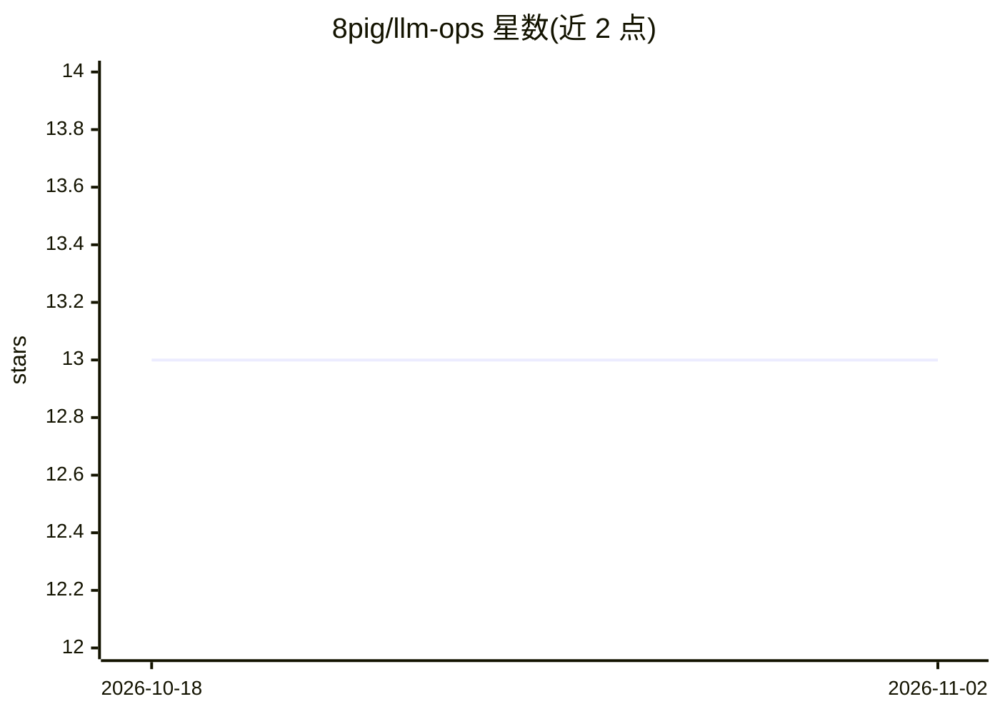

# 8pig/llm-ops

⭐ 13 · Python · 推送 2026-09-16 · [GitHub](https://github.com/8pig/llm-ops) · 个人维护 · 中文 README

**AI 原生应用开发平台：可视化编排 Agent 与工作流，接入 RAG 知识库**

开箱即用的 AI 应用开发平台：通过可视化方式编排单/多 Agent（函数调用循环）与基于 LangGraph 的工作流，支持 PDF/Word/图片等文档的解析切片与混合召回 RAG（Weaviate 向量检索 + jieba 关键词），可一键发布为网页应用与带 API Key 鉴权的开放 API。兼容 OpenAI/DashScope/月之暗面/百度千帆，本地向量化走 Ollama。Flask + Vue 3 技术栈，Docker Compose 部署。README 声明主要用于学习与二次开发参考。

## 筛选速览

| 维度 | 判定 | 备注 |
|---|---|---|
| AI 角色 | `ai-ecosystem` | LLM/agent 周边工具 |
| 许可风险 | `none` | — |
| 部署形态 | `self-host` | docker 或自建部署 |
| 模型依赖 | local-ok | 支持本地模型 |
| 硬件要求 | — | 无带数字的原话,不猜 |
| 安装摩擦 | `low` | 无编译、无系统依赖或容器化 |
| 成熟度 | — | 结构信号不足 |

## 能力要点

- 单/多 Agent 运行框架与 LangGraph 可视化工作流编排
- 多格式文档 RAG：混合召回 + Redis 向量缓存
- 网页应用与开放 API 一键发布，含 API Key 鉴权与限额
- OpenAI/DashScope/Moonshot/千帆多模型接入，Ollama 本地向量化

## 适用场景

- 可视化搭建带知识库的问答与对话应用
- 把内部文档做成 RAG 知识库供 Agent 检索
- 将编排好的 AI 应用以开放 API 形式提供给二次开发

## 场景标签

`Agent 框架` `多智能体` `工作流自动化` `RAG` · 领域:Agent 开发

## 证据(README 行号)

> L3: LLMOps 是一个开箱即用的 **AI 原生应用开发平台**：通过可视化方式编排 **智能体（Agent）** 与 **工作流（Workflow）**，接入 **知识库（RAG）** 与多款大模型，即可快速构建问答、对话、数据分析
> L11: - **可视化工作流**：基于 **LangGraph** 的图形化编排，复杂逻辑可视化构建、调试

## 星数曲线

2026-10-18 13 → 2026-11-02 13（+0）

---
*卡片 v1 · prompt 1.4 · 生成 2026-10-31 · 置信度 high · 依据 README sha `062a9ac6e596` · [字段定义](../../DATASET.md)*
