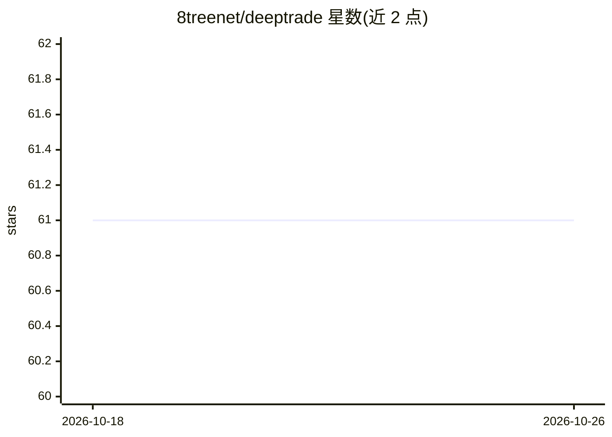

# 8treenet/deeptrade

⭐ 61 · Go · 推送 2026-08-16 · [GitHub](https://github.com/8treenet/deeptrade) · 个人维护 · 中文 README

**面向 ETH 期货的 LLM 量化交易系统（Go）**

Go 编写的加密货币量化交易 Agent，专用于 ETH 期货：并发获取 Binance 价格、K线、订单簿、持仓等实时数据，计算 RSI/MACD/布林带等技术指标，将数据转为结构化提示发送给多个 LLM（DeepSeek 主决策、Qwen 备用、GLM 辅助）生成开仓/平仓/止损信号并自动执行。内置仓位与杠杆控制、交易时间限制、记忆系统与邮件通知，支持测试网/生产网切换。需 Go 1.24+、Binance 与 LLM API 密钥，源码构建运行，README 声明仅用于教育研究目的。

## 筛选速览

| 维度 | 判定 | 备注 |
|---|---|---|
| AI 角色 | `ai-native` | 本体是模型或模型工具 |
| 许可风险 | `none` | — |
| 部署形态 | `None` |  |
| 模型依赖 | locked-api |  |
| 硬件要求 | — | 无带数字的原话,不猜 |
| 安装摩擦 | `low` | 无编译、无系统依赖或容器化 |
| 成熟度 | — | 结构信号不足 |

## 能力要点

- 多 LLM 提供商决策（DeepSeek/Qwen/GLM），开仓与持仓跟踪可用不同模型
- 并发获取 Binance 实时市场数据并计算趋势/动量/波动率多类技术指标
- 自动开仓、平仓、加仓、止损止盈与仓位/杠杆控制
- 测试网与生产环境可切换，含记忆系统与邮件通知

## 适用场景

- 在 Binance 测试网验证 LLM 驱动的 ETH 期货交易策略
- 让 LLM 基于技术指标与实时行情自动生成并执行交易信号
- 研究多模型分工（开仓决策/持仓跟踪）在量化交易中的用法

## 场景标签

`金融量化` · 领域:学习与行业

## 证据(README 行号)

> L6: 一个基于人工智能的加密货币量化交易系统，专门用于ETH期货交易。系统集成了多种LLM提供商（DeepSeek、Qwen等）进行智能决策，并实现了高级技术指标分析和实时市场数据处理。📊 Agent生成的报告预览
> L99: 系统将市场数据和技术指标转换为结构化提示，发送给LLM获取交易信号。

## 星数曲线

2026-10-18 61 → 2026-10-26 61（+0）

---
*卡片 v1 · prompt 1.4 · 生成 2026-10-24 · 置信度 high · 依据 README sha `826882ba8d57` · [字段定义](../../DATASET.md)*
