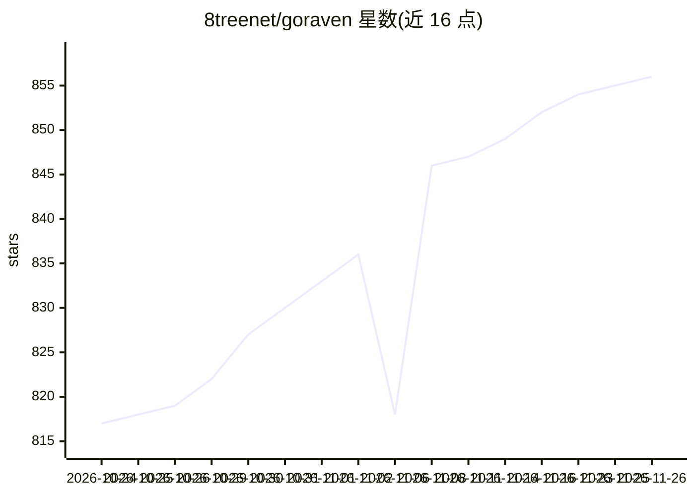

# 8treenet/goraven

⭐ 856 · Go · Apache-2.0 · 推送 2026-11-18 · [GitHub](https://github.com/8treenet/goraven) · [官网](https://goraven.dev) · 组织维护 · 中文 README

**团队自托管 AI Agent 平台：读文件、跑代码、调 API 交付结果**

Go 编写、React/TypeScript 前端的开源自托管 Agent 运行时。为团队每人提供独立 Agent 工作区，Agent 可读写文件、执行 Shell、调用 MCP 工具链、RAG 检索知识库。团队共享项目与技能市场（提示词/脚本/工作流打包为技能一键安装），管理员控制模型配额、工具权限与数据访问。提供插件钩子（会话前后、工具调用、SSE 事件注入自定义逻辑），支持 OpenAI、Claude、DeepSeek、Qwen、GLM 及兼容 API。一条 Docker 命令部署，数据不出服务器。

## 筛选速览

| 维度 | 判定 | 备注 |
|---|---|---|
| AI 角色 | `ai-native` | 本体是模型或模型工具 |
| 许可风险 | `permissive` | Apache-2.0 |
| 部署形态 | `self-host` | docker 或自建部署 |
| 模型依赖 | — | README 未给出锁定关系 |
| 硬件要求 | — | 无带数字的原话,不猜 |
| 安装摩擦 | `low` | 无编译、无系统依赖或容器化 |
| 成熟度 | — | 结构信号不足 |

## 能力要点

- 每个成员独立 Agent 工作区，共享项目与技能库，管理员控制配额与权限
- Agent 直接读写文件、运行 Shell、调用 MCP 工具链
- RAG 实时检索：策略/文档/业务资料入库，回答带来源
- 插件钩子在会话/工具调用/SSE 事件生命周期注入自定义逻辑

## 适用场景

- 团队内部自托管部署，任务由 Agent 拆解并行执行交付结果
- 将内部 API、数据库、私有服务接入 Agent 工具链
- 政策文档等资料入库做带来源的知识问答

## 场景标签

`Agent 框架` `RAG` `AI 助手` · 领域:Agent 开发

## 证据(README 行号)

> L25: GoRaven gives every person on your team an independent Agent workspace. Not a chat window — a workstation. The Agen
> L53: One Docker command and it's running. Data never leaves your server. Works with OpenAI, Claude, DeepSeek, Qwen, GLM,

## 星数曲线

2026-10-24 817 → 2026-11-26 856（+39）

---
*卡片 v1 · prompt 1.4 · 生成 2026-11-24 · 置信度 high · 依据 README sha `00388b47b801` · [字段定义](../../DATASET.md)*
