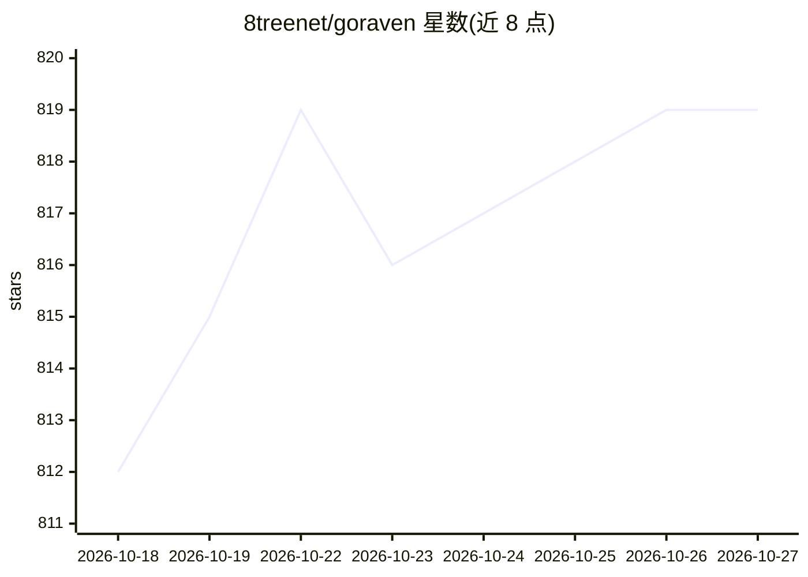

# 8treenet/goraven

⭐ 819 · Go · Apache-2.0 · 推送 2026-10-16 · [GitHub](https://github.com/8treenet/goraven) · [官网](https://goraven.dev) · 组织维护 · 中文 README

**面向团队的自托管 AI Agent 平台，Agent 执行任务并交付结果**

自托管开源 Agent 运行时平台：为团队成员提供相互隔离的 Agent 工作区，Agent 可读写文件、运行 Shell 命令、调用 MCP 工具链与内部 API、检索 RAG 知识库并生成图表与报告。内置技能市场（一键安装提示词/脚本/工作流）、插件生命周期钩子，管理员可控制模型配额、工具权限与数据访问。通过 Docker 一键部署，数据留在本地服务器，支持 OpenAI、Claude、DeepSeek、Qwen、GLM 等兼容 API。

## 筛选速览

| 维度 | 判定 | 备注 |
|---|---|---|
| AI 角色 | `ai-native` | 本体是模型或模型工具 |
| 许可风险 | `permissive` | Apache-2.0 |
| 部署形态 | `self-host` | docker 或自建部署 |
| 模型依赖 | — | README 未给出锁定关系 |
| 硬件要求 | — | 无带数字的原话,不猜 |
| 安装摩擦 | `low` | 无编译、无系统依赖或容器化 |
| 成熟度 | — | 结构信号不足 |

## 能力要点

- Agent 可读写文件、运行 Shell、调用 MCP 工具链与内部 API
- 团队隔离工作区，管理员控制模型配额、工具权限与数据访问
- 提示词/脚本/工作流打包为技能，一键安装与集中维护
- 对话、工具调用、SSE 事件流等生命周期插件钩子

## 适用场景

- 团队共享 Agent 工作区协作完成数据分析、报告生成等任务
- 在内网自托管 Agent 平台并接入自有 API 与知识库
- 通过技能市场统一维护团队的提示词与工作流

## 场景标签

`Agent 框架` `数据分析` · 领域:Agent 开发

## 证据(README 行号)

> L25: GoRaven gives every person on your team an independent Agent workspace. Not a chat window — a workstation. The Agen
> L53: One Docker command and it's running. Data never leaves your server. Works with OpenAI, Claude, DeepSeek, Qwen, GLM,

## 星数曲线

2026-10-18 812 → 2026-10-27 819（+7）

---
*卡片 v1 · prompt 1.4 · 生成 2026-10-21 · 置信度 high · 依据 README sha `c7cc9dee9a3d` · [字段定义](../../DATASET.md)*
