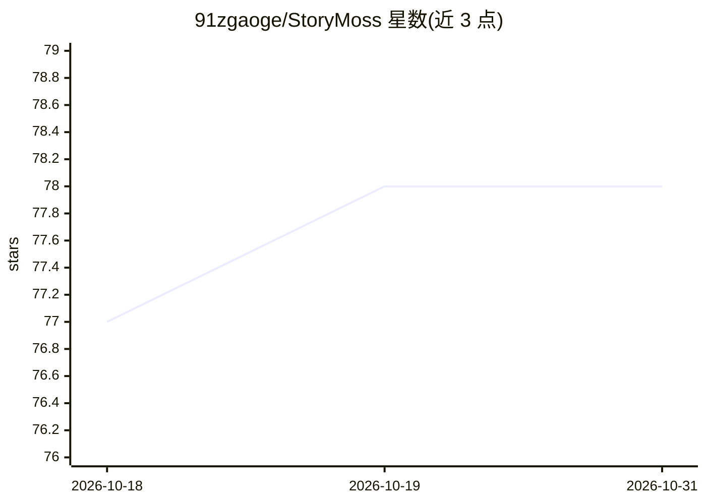

# 91zgaoge/StoryMoss

⭐ 78 · Rust · 推送 2026-10-30 · [GitHub](https://github.com/91zgaoge/StoryMoss) · [官网](https://storymoss.top) · 个人维护 · 中文 README

**AI 辅助小说创作的桌面应用，多代理续写与故事资产管理**

基于 Tauri+Rust+React 的桌面写作软件，面向小说作者：幕前沉浸写作、幕后工作室管理角色/世界观/知识图谱/伏笔等故事资产。AI 部分由主创/管理/编辑审计三代理并行协作，每章经加权质量门（阈值 0.75）交付；支持续写前前文检索、分层记忆摘要、角色生死与关系校验，并从用户修改中提炼文风规则。模型接入支持 OpenAI/Anthropic/Ollama/本地 API，角色×任务模型路由。提供预构建安装包与源码运行两种途径。

## 筛选速览

| 维度 | 判定 | 备注 |
|---|---|---|
| AI 角色 | `ai-native` | 本体是模型或模型工具 |
| 许可风险 | `none` | — |
| 部署形态 | `library` | 以包/库形式分发 |
| 模型依赖 | local-ok | 支持本地模型 |
| 硬件要求 | — | 无带数字的原话,不猜 |
| 安装摩擦 | `low` | 无编译、无系统依赖或容器化 |
| 成熟度 | — | 结构信号不足 |

## 能力要点

- 主创/管理/编辑审计三代理黑板协作，Gate v2 加权质量门（阈值 0.75）
- 每章正文自动提取角色/关系/世界观/大纲回流资产库，手工编辑不被覆盖
- 续写前向量检索前文原文 + 章节/段/全书三层摘要记忆
- 持续学习：Tab 接受/Esc 放弃回灌章法偏好，手改提炼文风规则

## 适用场景

- 长篇小说创作中让 AI 续写并保持角色/伏笔/知识边界一致
- 集中管理角色、世界观、场景、知识图谱等故事资产
- 通过多模型路由为创作、工具、后台任务分配不同模型

## 场景标签

`AI 写作` `知识图谱` `知识库管理` · 领域:内容生成

## 证据(README 行号)

> L5:  🌿 越写越懂的 AI 小说创作桌面应用
> L21: |🤖|**Agency 多代理创作**|主创 / 管理 / 编辑审计三代理黑板并行协作，每章经 Gate v2 加权质量门（代码 0.2 / 规则 0.3 / 编辑 0.5，阈值 0.75）才交付；你的修改率作为独立信号回流|
> L29: |🔌|**多模型适配**|OpenAI / Anthropic / Ollama / 本地 API，角色 × 任务模型路由|

## 星数曲线

2026-10-18 77 → 2026-10-31 78（+1）

---
*卡片 v1 · prompt 1.4 · 生成 2026-10-24 · 置信度 mid · 依据 README sha `6f48f1fa49ff` · [字段定义](../../DATASET.md)*
