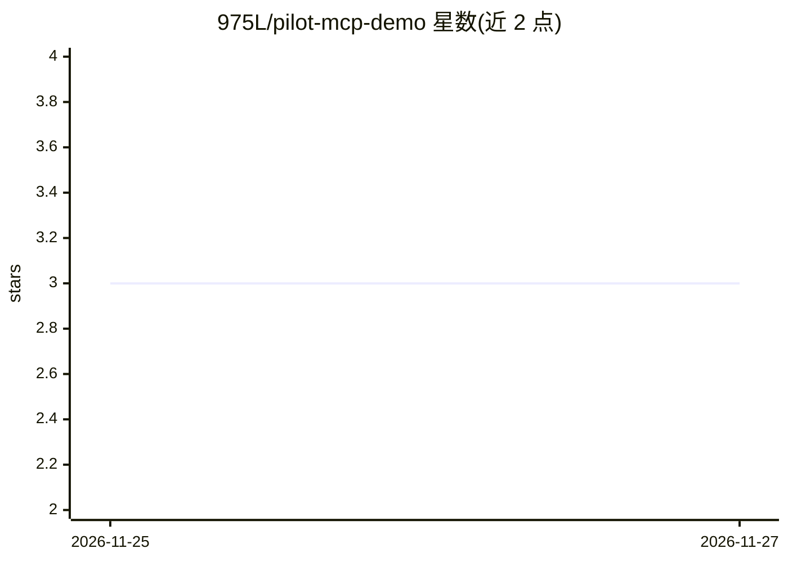

# 975L/pilot-mcp-demo

⭐ 3 · PHP · MIT · 推送 2026-11-21 · [GitHub](https://github.com/975L/pilot-mcp-demo) · [官网](https://bundles.975l.com/pages/pilot-bundle) · 个人维护

**Symfony AI/MCP hackathon 演示：AI agent 经 MCP 端点操作 Pilot 卡片**

为 Symfony AI & MCP hackathon 构建的演示项目：网站自身作为 MCP 服务器（/api/mcp），各 c975L bundle 向其注册工具（Pilot、Book、Gallery、Social），AI agent 以某账号权限对项目卡片执行步骤，在卡片上向用户追问缺失信息，发布由编辑者批准后完成。agent 可用 Claude Code、Symfony AI agent（Anthropic API）或任意 OpenAI 兼容 API。agent token 受限、可只读、会过期并记录活动日志。

## 筛选速览

| 维度 | 判定 | 备注 |
|---|---|---|
| AI 角色 | `ai-ecosystem` | LLM/agent 周边工具 |
| 许可风险 | `permissive` | MIT |
| 部署形态 | `None` |  |
| 模型依赖 | — | README 未给出锁定关系 |
| 硬件要求 | — | 无带数字的原话,不猜 |
| 安装摩擦 | `low` | 无编译、无系统依赖或容器化 |
| 成熟度 | — | 结构信号不足 |

## 能力要点

- 站点自身即 MCP 服务器，各 bundle 注册工具，与后台同套校验
- 支持 Claude Code / Anthropic / 任意 OpenAI 兼容 API（含本地模型）
- agent token 限账号作用域、可只读、可过期，写入均有活动日志
- 帖子保持草稿直至编辑者批准，人审流程内建

## 适用场景

- 演示如何把 AI agent 接入 Symfony 应用的 MCP 端点
- 让 agent 起草站点内容并在项目卡片上人机协作确认
- 以最小权限 agent token 安全地委托自动化操作

## 场景标签

`工作流自动化` · 领域:效率与自动化

## 证据(README 行号)

> L32: - **The site is its own MCP server.** With `mcp/sdk`, `/api/mcp` lives inside CoreBundle: each bundle adds its tool
> L45: - `src/Command/AgentRunCommand.php`: the Symfony AI agent, its tools drawn from `/api/mcp`.

## 星数曲线

2026-11-25 3 → 2026-11-27 3（+0）

---
*卡片 v1 · prompt 1.4 · 生成 2026-11-24 · 置信度 high · 依据 README sha `be4e082901b4` · [字段定义](../../DATASET.md)*
