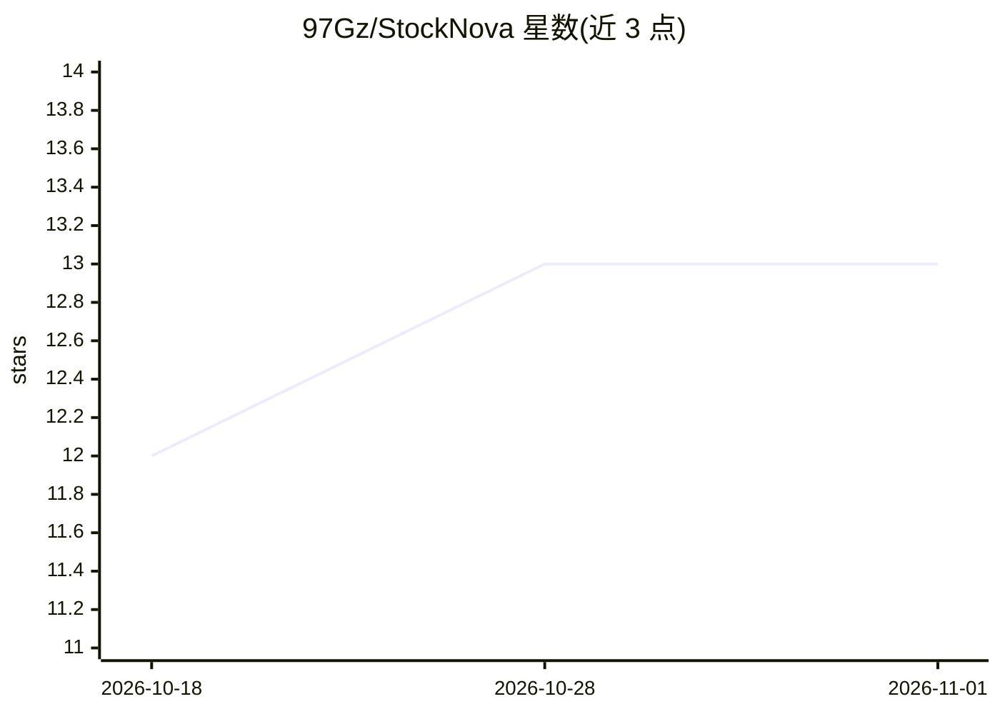

# 97Gz/StockNova

⭐ 13 · Python · MIT · 推送 2026-07-28 · [GitHub](https://github.com/97Gz/StockNova) · [官网](https://github.com/97Gz/StockNova/releases/latest) · 个人维护 · 中文 README

**本地运行的 A 股智能投研终端，多角色 AI 团队诊股**

面向 A 股个人投资者的开源本地投研工作台，覆盖行情、选股策略、回测、持仓诊断、实时快讯等模块。核心机制为 16 节点、17 角色的 AI 工作流：七维并行分析、多空辩论、风控会签，输出评级/仓位/买卖点；指标由本地 Python 计算，AI 仅做解读。支持回溯诊断用 +5/10/20/60 日真实走势校验 AI 结论。行情落 DuckDB、业务数据落 SQLite，不连券商账户。提供 Windows 桌面端、开发模式与 Docker 三种运行方式，AI 需配置 OpenAI 兼容 API Key（默认 DeepSeek）。

## 筛选速览

| 维度 | 判定 | 备注 |
|---|---|---|
| AI 角色 | `ai-native` | 本体是模型或模型工具 |
| 许可风险 | `permissive` | MIT |
| 部署形态 | `desktop` | 安装包/桌面程序 |
| 模型依赖 | local-ok | 支持本地模型 |
| 硬件要求 | — | 无带数字的原话,不猜 |
| 安装摩擦 | `low` | 无编译、无系统依赖或容器化 |
| 成熟度 | — | 结构信号不足 |

## 能力要点

- 16 节点 17 角色 AI 工作流：七维分析→多空辩论→风控会签→操作清单
- 回溯诊断以 +5/10/20/60 日真实走势校验 AI 目标价/止损价
- 44 因子库 + 24 策略 + 真实交易约束回测（次日成交/一字板跳过等）
- 100% 本地运行，行情落 DuckDB、业务数据落 SQLite，不连账户

## 适用场景

- 一键对个股做多角色 AI 诊股，得到评级/仓位/买卖点清单
- 用历史某日回溯诊断，验证 AI 结论是否兑现
- 44 因子策略选股与真实约束下的策略回测
- 盘中接收 7×24 财经快讯与 AI 盘面摘要

## 场景标签

`金融量化` `多智能体` · 领域:Agent 开发

## 证据(README 行号)

> L23: 它是一款完全开源、**本地运行、数据自持** 的 A 股个人投研工作台。把散户每天要做的事 —— 看盘、选股、复盘、盯持仓、读消息 —— 收进一个统一界面，并在关键环节接入大模型，用 **「一支多角色 AI 投研团队」** 替你把
> L29: - 🧠 **一支 17 角色的 AI 投研团队**：点一下，技术 / 资金 / 消息 / 基本面 / 宏观 / 量化 / 板块**七维并行分析** → 多空辩论 → 风控三方会签 → 组合经理给出**可执行操作清单**，而不是一句
> L63: 这是星智股区别于普通看盘软件的灵魂。一次「深度诊股」会驱动 **16 个节点、17 个 AI 角色** 协同工作，模拟一家投研机构的完整决策链路：

## 星数曲线

2026-10-18 12 → 2026-11-01 13（+1）

---
*卡片 v1 · prompt 1.4 · 生成 2026-10-31 · 置信度 high · 依据 README sha `b17a8ad795ef` · [字段定义](../../DATASET.md)*
