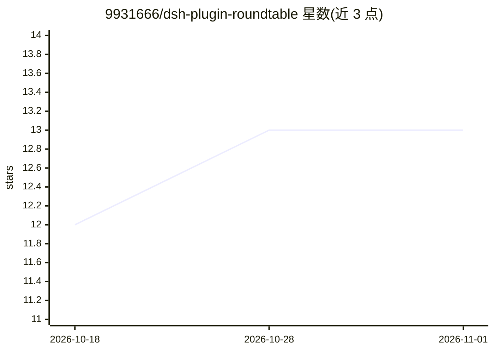

# 9931666/dsh-plugin-roundtable

⭐ 13 · TypeScript · MIT · 推送 2026-10-25 · [GitHub](https://github.com/9931666/dsh-plugin-roundtable) · 个人维护 · 中文 README

**DeepSeek Harness 插件：把单次会话变成主持人+多专家圆桌会议**

DeepSeek Harness（0.2.0-rc.2+）的插件，把一次会话升级为圆桌会议：DeepSeek 任主持人，拉起一圈可续聊的专家子代理（可指定不同厂商模型），在可视化拓扑图上以带箭头连线组织协作。提供三种模式：主持人统筹、多模型平等互辩、针锋相对红队评审（最多 3 轮闭环复审、观点三态表态、驳回必填理由）。含轮数/Token 双预算熔断、知识库摘要缓存、会议状态文件级持久化与 Markdown 整场导出。已知限制：RPC 通道不暴露会话身份、多进程同改一场会议不保证一致。经 dsh plugin 命令从 npm 安装或源码构建。

## 筛选速览

| 维度 | 判定 | 备注 |
|---|---|---|
| AI 角色 | `ai-ecosystem` | LLM/agent 周边工具 |
| 许可风险 | `permissive` | MIT |
| 部署形态 | `library` | 以包/库形式分发 |
| 模型依赖 | locked-api |  |
| 硬件要求 | — | 无带数字的原话,不猜 |
| 安装摩擦 | `low` | 无编译、无系统依赖或容器化 |
| 成熟度 | `idea` | |

## 能力要点

- 三种协作模式：主持人统筹 / 多模型平等互辩 / 针锋相对红队评审
- 可视化拓扑：环形专家节点 + 方向连线 + 汇聚网关结构化摘要
- 红队评审闭环：观点证据分级、三态表态、最多 3 轮复审、Markdown 导出
- 轮数/Token 双预算熔断与知识库摘要缓存（避免重复读取）

## 适用场景

- 让多位不同厂商模型的专家辩论同一议题并由我拍板
- 对定稿方案发起红队评审，逐条确认缺陷
- 用自然语言在 DSH 中组织多专家协作产出汇总报告

## 场景标签

`多智能体` · 领域:Agent 开发

## 证据(README 行号)

> L4:  DeepSeek Harness 插件
> L11: > 你只负责抛出议题。DeepSeek 成为主持人，在拓扑图上拉起一圈专家节点，用带箭头的连线组织协作，经过汇聚网关汇总，遇到分歧时把决策权交还给你。
> L118: dsh plugin --profile web add @y9931666/dsh-plugin-roundtable@next

## 星数曲线

2026-10-18 12 → 2026-11-01 13（+1）

---
*卡片 v1 · prompt 1.4 · 生成 2026-10-31 · 置信度 high · 依据 README sha `f4e5f5f5581a` · [字段定义](../../DATASET.md)*
