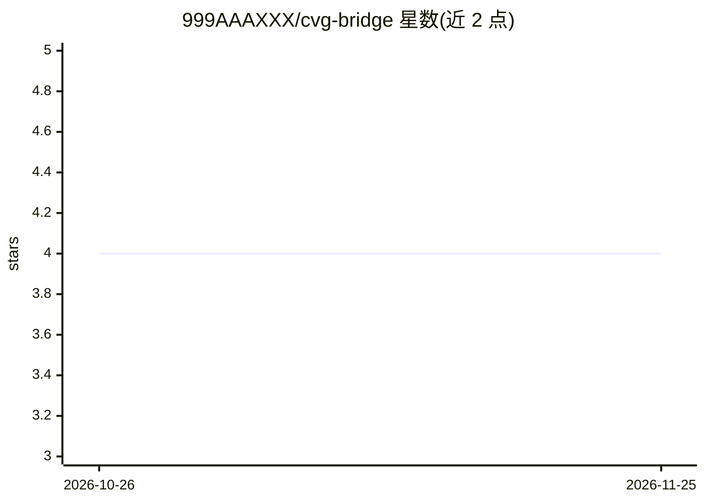

# 999AAAXXX/cvg-bridge

⭐ 4 · JavaScript · MIT · 推送 2026-10-25 · [GitHub](https://github.com/999AAAXXX/cvg-bridge) · 个人维护 · 中文 README

**把 Converge/enter.pro 反代成本地 OpenAI/Anthropic 兼容 API 的桥接服务**

Node.js 编写的本地反向代理，将 Converge/enter.pro 上游网关转换为 OpenAI（/v1/chat/completions）与 Anthropic 原生（/v1/messages）兼容接口，供 opencode、OpenAI SDK 或内置网页调用。机制包括：按 sub 去重的多账号池在 401/额度耗尽时自动切号重试、基于 sha256 前缀的 prompt cache 注入（OpenAI 系补 prompt_cache_key、Claude 自动打 cache_control 断点、Gemini 走隐式前缀）、流式重切输出、单页控制台管理账号与用量，调用台账持久化到 usage.jsonl。零第三方依赖，仅需 Node 18+；token 约 24 小时过期需用附带的 Python 脚本经 cookie 续期。

## 筛选速览

| 维度 | 判定 | 备注 |
|---|---|---|
| AI 角色 | `ai-ecosystem` | LLM/agent 周边工具 |
| 许可风险 | `permissive` | MIT |
| 部署形态 | `None` |  |
| 模型依赖 | — | README 未给出锁定关系 |
| 硬件要求 | — | 无带数字的原话,不猜 |
| 安装摩擦 | `low` | 无编译、无系统依赖或容器化 |
| 成熟度 | — | 结构信号不足 |

## 能力要点

- 本地暴露 OpenAI / Anthropic 兼容端点，支持流式与 tool_calls
- 多账号池按 sub 去重，401/额度耗尽自动切号并重试同一请求
- 按模型族注入缓存：OpenAI 系 prompt_cache_key、Claude cache_control 断点、Gemini 隐式前缀
- 单页控制台覆盖对话、模型矩阵、用量台账与账号池增删改切

## 适用场景

- 让 opencode 或任意 OpenAI SDK 通过本地端点调用 Converge/enter.pro 的模型
- 多个账号轮换使用，额度耗尽时自动切换不中断请求
- 在控制台查看每次调用的 prompt/cached/completion tokens 与估算 credits

## 场景标签

`模型网关` · 领域:Agent 开发

## 证据(README 行号)

> L3: 把 **Converge / enter.pro** 的模型反代成本地 **OpenAI / Anthropic 兼容**服务，供 opencode、任意 OpenAI SDK 或内置网页直接调用。
> L13: **cvg-bridge** exposes **Converge / enter.pro** models as local **OpenAI- and Anthropic-compatible** APIs, so you c

## 星数曲线

2026-10-26 4 → 2026-11-25 4（+0）

---
*卡片 v1 · prompt 1.4 · 生成 2026-11-21 · 置信度 high · 依据 README sha `211bac57d091` · [字段定义](../../DATASET.md)*
