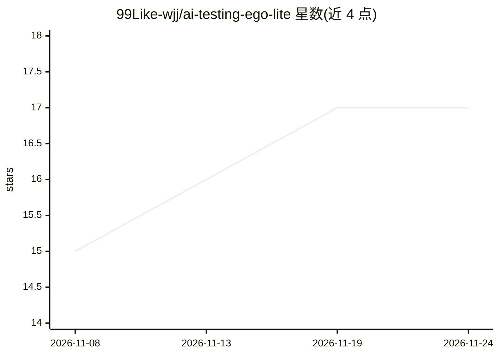

# 99Like-wjj/ai-testing-ego-lite

⭐ 17 · TypeScript · MIT · 推送 2026-11-16 · [GitHub](https://github.com/99Like-wjj/ai-testing-ego-lite) · 个人维护 · 中文 README

**面向 Web 应用的 AI 自动化测试 Skill：AI 自主设计用例、执行并留证**

一个运行于 agent 宿主（Codex、Claude Code 等）的 AI 测试 Skill：AI 负责理解需求、设计用例、经 Ego Lite 操作浏览器执行测试并依据真实证据判定结果，本项目提供测试记录、证据留存、接口观测、回归资料与报告生成等工具能力。报告以独立 HTML/JSON/Markdown 交付，关键 UI 结果须有真实页面截图；支持离线评审导出、用例冻结与并发配置（默认串行）。配套的 project-knowledge-maintainer 负责项目知识库维护，二者通过独立格式协作。当前版本 0.2.2。

## 筛选速览

| 维度 | 判定 | 备注 |
|---|---|---|
| AI 角色 | `ai-ecosystem` | LLM/agent 周边工具 |
| 许可风险 | `permissive` | MIT |
| 部署形态 | `None` |  |
| 模型依赖 | — | README 未给出锁定关系 |
| 硬件要求 | — | 无带数字的原话,不猜 |
| 安装摩擦 | `low` | 无编译、无系统依赖或容器化 |
| 成熟度 | — | 结构信号不足 |

## 能力要点

- AI 自主设计用例并依据真实证据判定四态结果，工具不替 AI 判定业务正确性
- 接口观测 v3：自动记录授权页面的 Fetch/XHR/SSE/WebSocket 正文供 AI 查询
- 独立 HTML/JSON/Markdown 报告，共享统计，含证据 ID、根因确认程度与历史
- 默认串行执行，可显式配置 maxParallelCases 并发，worker 独立留证、协调者复核

## 适用场景

- 让 AI agent 对 Web 应用做新功能测试与已有功能回归
- 生成带截图与接口证据的可审计测试报告
- 通过离线 HTML 让人工评审用例并导出反馈

## 场景标签

`浏览器自动化` · 领域:效率与自动化

## 证据(README 行号)

> L7: **面向 Web 应用的 AI Testing Skill。** AI 自主分析需求、设计用例、通过 Ego Lite 执行并依据真实证据判断结果，支持新功能与已有功能回归。
> L19: 本项目由 AI 主导自动化测试。AI 负责理解需求、设计用例、自主探索页面、选择操作与验证方法，并依据实际证据判断结果。我们提供可按需组合的具体能力工具，以及测试规范和经验参考，帮助 AI 完成工作，而不是用固定流程替它决定每一步
> L161: 已整合跨宿主修复提交 8e6e2d9，当前保留 v9 目标评估与监控设计。宿主负责真实子 Agent 的创建、上下文、权限、等待和收尾；本工具不提供固定宿主调度器。跨终端执行前参阅宿主条件与交接。Codex 使用 $ai-tes

## 星数曲线

2026-11-08 15 → 2026-11-24 17（+2）

---
*卡片 v1 · prompt 1.4 · 生成 2026-11-18 · 置信度 high · 依据 README sha `2df9dfd171c6` · [字段定义](../../DATASET.md)*
