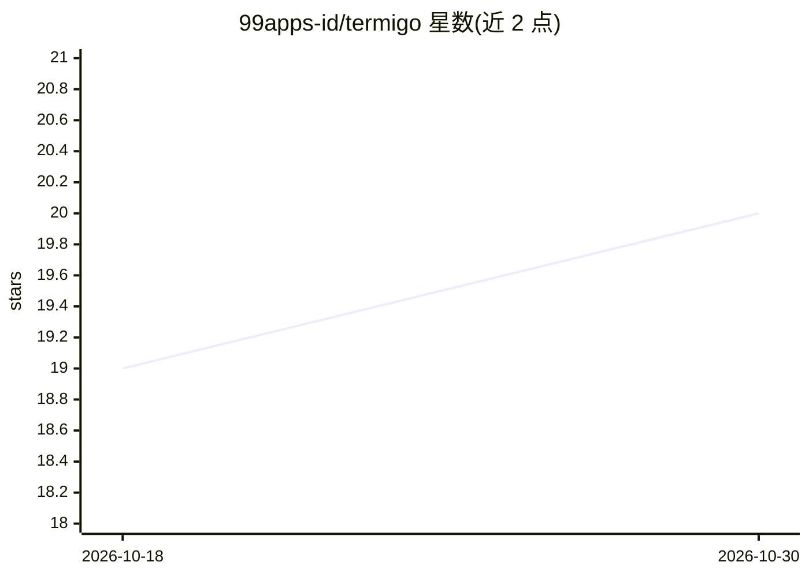

# 99apps-id/termigo

⭐ 20 · TypeScript · Apache-2.0 · 推送 2026-10-29 · [GitHub](https://github.com/99apps-id/termigo) · 组织维护

**终端优先的 AI 开发环境：编辑器+终端+SSH+AI Agent 一体化**

基于 Tauri 2 + Rust 与 React 19 前端的开源桌面开发环境：内含原生 PTY 终端、代码编辑器、文件管理器、git 图形化源码控制与网页预览，以及一个 agentic AI 侧面板。AI 部分支持 BYOK 接入 OpenAI/Anthropic/Groq/DeepSeek 等十余家及本地 LM Studio/MLX/Ollama，提供约 125 个工具、技能自写自读（SKILL.md）、项目记忆文件、并行子代理（含渗透测试专员）、断线/超限自动恢复与上下文压缩续跑。另配 Go CLI（termi-go）做自动化、MCP 与脚手架。无遥测、无账号要求。

## 筛选速览

| 维度 | 判定 | 备注 |
|---|---|---|
| AI 角色 | `ai-enhanced` | 去掉 AI 部分产品仍成立 |
| 许可风险 | `permissive` | Apache-2.0 |
| 部署形态 | `desktop` | 安装包/桌面程序 |
| 模型依赖 | local-ok | 支持本地模型 |
| 硬件要求 | — | 无带数字的原话,不猜 |
| 安装摩擦 | `low` | 无编译、无系统依赖或容器化 |
| 成熟度 | — | 结构信号不足 |

## 能力要点

- BYOK 接入 10+ 提供商及本地 LM Studio/MLX/Ollama
- 代理可自写并复用 SKILL.md 技能，记忆持久化到 memory.md
- 并行子代理（可链式依赖、并发上限默认 4）与按需加载工具集（8.0k tokens/请求）
- 断线、配额耗尽、上下文超窗时自动暂停/压缩/续跑同一任务

## 适用场景

- 在单窗口内完成终端、编辑、SSH/SFTP 与 AI 代理协作开发
- 用自己的 API key 或本地模型跑代码代理任务
- 跨重启恢复中断的代理会话与终端进程

## 场景标签

`编码 Agent` · 领域:编码与开发

## 证据(README 行号)

> L23: **Termigo** is a lightweight open-source, terminal-first AI-native development
> L26: fully local models, a code editor, file explorer, source control with a git
> L67: - **BYOK providers:** OpenAI, Anthropic (Claude), Google (Gemini), Groq,

## 星数曲线

2026-10-18 19 → 2026-10-30 20（+1）

---
*卡片 v1 · prompt 1.4 · 生成 2026-10-29 · 置信度 mid · 依据 README sha `262ce7665c78` · [字段定义](../../DATASET.md)*
