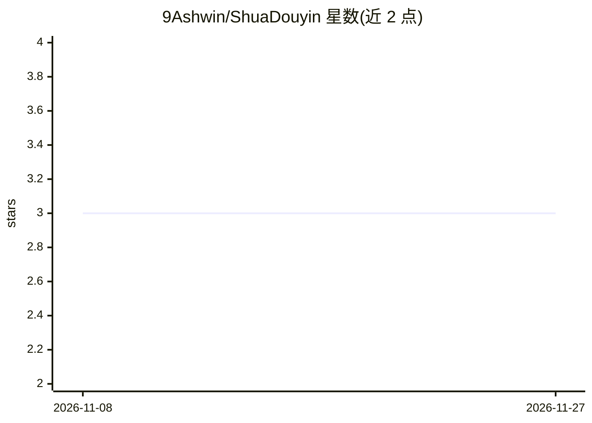

# 9Ashwin/ShuaDouyin

⭐ 3 · TypeScript · MIT · 推送 2026-11-01 · [GitHub](https://github.com/9Ashwin/ShuaDouyin) · 个人维护 · 中文 README

**让 AI Agent 带人格和记忆操作抖音的本地 CLI**

ShuaDouyin（命令 dy）是一个本地命令行工具，交给能执行 shell 的 AI Agent 调用，覆盖抖音搜索浏览、读作品与评论、点赞收藏关注、评论与私信发送、直播弹幕与送礼、关系跟进与日报等操作。项目不内建模型，使用用户已有的 Agent 与本机 Chrome 登录；人格、记忆与登录态保存在本地 ~/.dy 工作区，跨会话延续。对外动作需授权，写入操作带收据、--request-id 与 --dry-run 机制。需 Node.js 22.19+。

## 筛选速览

| 维度 | 判定 | 备注 |
|---|---|---|
| AI 角色 | `ai-enhanced` | 去掉 AI 部分产品仍成立 |
| 许可风险 | `permissive` | MIT |
| 部署形态 | `library` | 以包/库形式分发 |
| 模型依赖 | — | README 未给出锁定关系 |
| 硬件要求 | — | 无带数字的原话,不猜 |
| 安装摩擦 | `low` | 无编译、无系统依赖或容器化 |
| 成熟度 | `idea` | |

## 能力要点

- Agent 经 shell 执行 dy 命令完成搜索、互动、私信、直播等操作
- 人格、人物资料与带来源的记忆保存在本地工作区 ~/.dy
- 写入操作使用收据与唯一 --request-id，支持 --dry-run 验证
- 项目不内建模型，不需要单独配置模型 API Key

## 适用场景

- 让 Agent 搜索指定话题并阅读作品与评论后汇总
- 让 Agent 结合历史上下文起草私信回复
- 整理已记录的人物与到期跟进事项
- 按当天本地记录生成浏览日报

## 场景标签

`浏览器自动化` · 领域:效率与自动化

## 证据(README 行号)

> L10: 一个本地命令行工具，连接 Agent、抖音页面和持续积累的上下文。
> L22: **你定义名字、语气和边界，Agent 负责理解与判断，`dy` 提供操作和证据。** 项目不内建模型，也不运行定时任务；使用你已有的 Agent 和本机 Chrome。人设与记忆保存在本地，可以跨会话继续使用。

## 星数曲线

2026-11-08 3 → 2026-11-27 3（+0）

---
*卡片 v1 · prompt 1.4 · 生成 2026-11-22 · 置信度 high · 依据 README sha `72c912bfcc60` · [字段定义](../../DATASET.md)*
