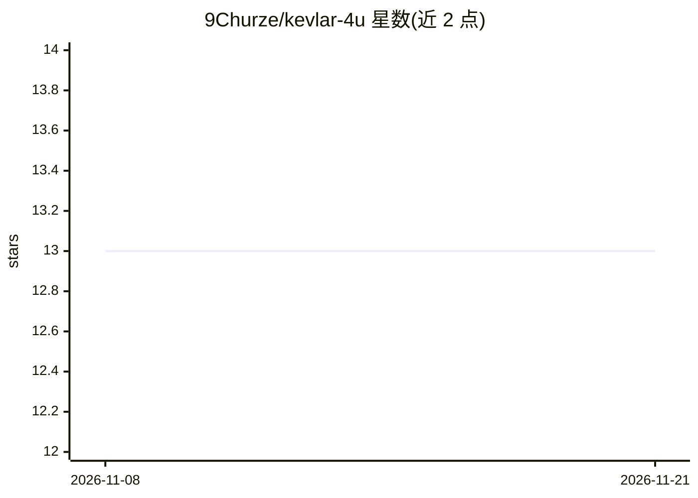

# 9Churze/kevlar-4u

⭐ 13 · TypeScript · AGPL-3.0 · 推送 2026-06-22 · [GitHub](https://github.com/9Churze/kevlar-4u) · 个人维护 · 中文 README

**发布前的 AI 舆情沙盒：多角色模拟网民吐槽，提前暴露表达盲点**

以 MCP 服务器/CLI 形式运行的社交媒体内容预审工具：将文章、推文、脚本、公告等交给两组 AI 流程——第一阶段由 6 个系统审计员按合规、社会风险、断章取义、网络文化、事实、跨语言等维度扫描；第二阶段由用户自定义的 RST 人格（年龄、兴趣、性格、平台文化等）产出模拟网友反应。支持 MCP Sampling、Direct API（Anthropic/OpenAI key）与单次推理矩阵填充三种执行模式。本地运行、AGPL-3.0；Pro 层需订阅激活，含服务器同步规则包与完整提示词。

## 筛选速览

| 维度 | 判定 | 备注 |
|---|---|---|
| AI 角色 | `ai-native` | 本体是模型或模型工具 |
| 许可风险 | `viral` | AGPL-3.0 |
| 部署形态 | `library` | 以包/库形式分发 |
| 模型依赖 | — | README 未给出锁定关系 |
| 硬件要求 | — | 无带数字的原话,不猜 |
| 安装摩擦 | `low` | 无编译、无系统依赖或容器化 |
| 成熟度 | — | 结构信号不足 |

## 能力要点

- 6 维度系统预审 + RST 人格模拟的两阶段审查管线
- 三种执行模式：MCP Sampling / Direct API / 单推理矩阵填充协议
- 自然语言描述即可生成审查员人格，存为 skills/*.json
- 本地运行，无遥测；Pro 经 Ed25519 验证同步策略包

## 适用场景

- 发推/发帖前让 AI 模拟各视角网友反应，找吐槽点
- 公关团队预审新闻稿的合规与舆情风险
- 创作者检测文案的断章取义与误读隐患

## 场景标签

`多智能体` · 领域:Agent 开发

## 证据(README 行号)

> L10: > **It simulates real reactions from different audiences — casual users, picky netizens, technical users, media per
> L69: When independent LLM access is available (MCP Sampling / Direct API), each auditor runs as a separate LLM call for 
> L121: |`review_content_wizard`|Review content|Submit content → Select platform → Pick reviewers → Confirm → Multi-dimens

## 星数曲线

2026-11-08 13 → 2026-11-21 13（+0）

---
*卡片 v1 · prompt 1.4 · 生成 2026-11-18 · 置信度 high · 依据 README sha `3dbdb2ac65a9` · [字段定义](../../DATASET.md)*
