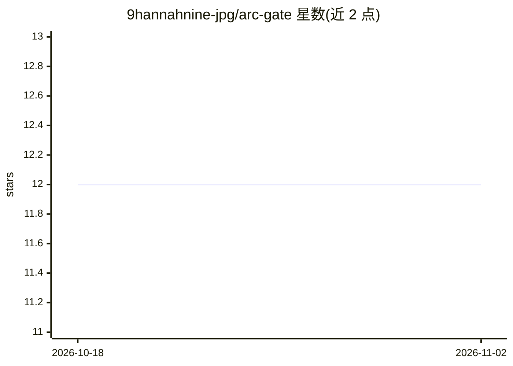

# 9hannahnine-jpg/arc-gate

⭐ 12 · Python · NOASSERTION · 推送 2026-07-16 · [GitHub](https://github.com/9hannahnine-jpg/arc-gate) · 个人维护

**AI agent 的 LLM 代理：拦截提示注入，阻止未授权指令执行**

位于 agent 与模型 API 之间的运行时治理代理，在提示到达模型前经四层检测（SVM 行为分类器、80+ 短语模式、Fisher-Rao 几何距离、CUSUM 会话监控）拦截指令权限转移类注入，被拦截的提示不会到达模型，检测开销约 350ms（README 另称中位延迟增加约 200ms）。面向使用 LangChain/CrewAI/MCP 构建 agent 的开发者，提供 pip 集成包与 Railway 自部署路径，附五种部署策略模板、/dashboard 监控页与基准工具。已知限制：数据字段内隐式指令、无显式权限转移语言的语义角色扮演攻击、多语言攻击覆盖有限。许可为 AGPL-3.0，另提供商业许可与 $29/月付费 API key。

## 筛选速览

| 维度 | 判定 | 备注 |
|---|---|---|
| AI 角色 | `ai-ecosystem` | LLM/agent 周边工具 |
| 许可风险 | `none` | NOASSERTION |
| 部署形态 | `library` | 以包/库形式分发 |
| 模型依赖 | — | README 未给出锁定关系 |
| 硬件要求 | — | 无带数字的原话,不猜 |
| 安装摩擦 | `low` | 无编译、无系统依赖或容器化 |
| 成熟度 | — | 结构信号不足 |

## 能力要点

- 四层检测：行为分类器、短语检查、几何检测、会话监控
- LangChain / CrewAI / MCP 集成包（pip 安装）
- browser_agent / finance_agent / rag_assistant 等部署策略模板
- 自托管模型可用 arc-sentry 行为分类器包（pip）

## 适用场景

- 给运行中的 agent 加提示注入防护，拦截网页/邮件/工具输出中的隐藏指令
- 金融类 agent 限制支付转账等高风险动作
- RAG 管线中防止检索文档内容触发工具调用

## 场景标签

`网络安全` · 领域:学习与行业

## 证据(README 行号)

> L5: Arc Gate is the runtime governance proxy for AI agents. It sits between your agent and the model API, blocking instr
> L137: Four detection layers run on every prompt before it reaches your model:
> L149: ## Deploy your own instance

## 星数曲线

2026-10-18 12 → 2026-11-02 12（+0）

---
*卡片 v1 · prompt 1.4 · 生成 2026-11-01 · 置信度 high · 依据 README sha `2b405c91e2bb` · [字段定义](../../DATASET.md)*
