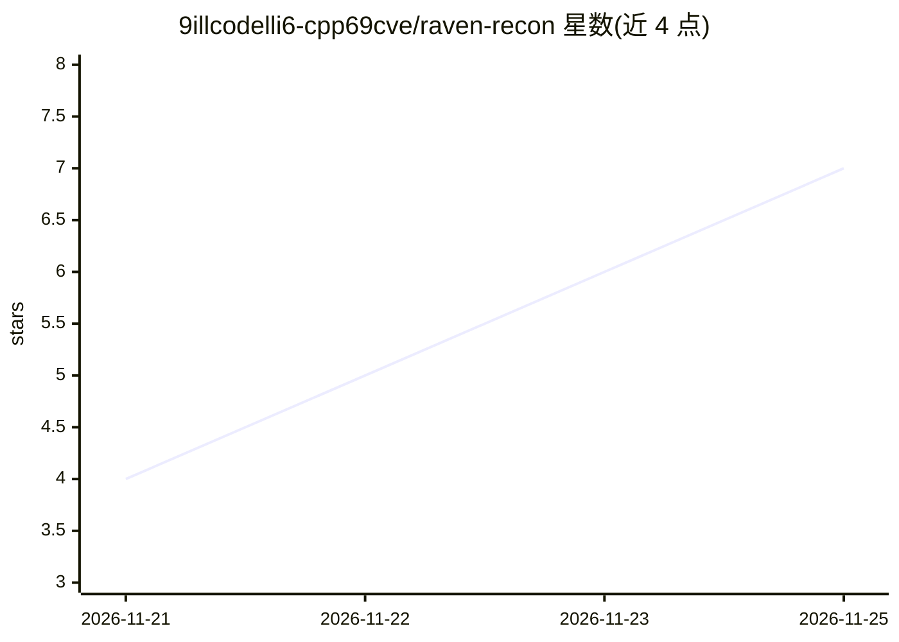

# 9illcodelli6-cpp69cve/raven-recon

⭐ 7 · Python · AGPL-3.0 · 推送 2026-11-19 · [GitHub](https://github.com/9illcodelli6-cpp69cve/raven-recon) · 个人维护

**面向漏洞赏金与渗透测试者的范围感知侦察与 AI 辅助测试工作台**

RAVEN Recon 是一个安全测试工作台：按程序划分工作区并强制范围校验（阻断越界与私有地址），提供证书透明子域名收集、HTTP 探测、端点发现、请求重放与模糊测试实验室、访问控制/XSS 分析实验室及 Markdown 报告导出。AI 部分为可选：接入 Claude API 或本地 Ollama 模型驱动的对话与 Agent，Agent 的每个请求与命令需人工逐条批准，并配有紧急停止、预算与速率限制、Linux 离线命令沙箱。提供 Windows 与 Kali/Linux 的桌面应用、本地 Web UI 与终端三种运行方式，仅限授权测试使用。

## 筛选速览

| 维度 | 判定 | 备注 |
|---|---|---|
| AI 角色 | `ai-enhanced` | 去掉 AI 部分产品仍成立 |
| 许可风险 | `viral` | AGPL-3.0 |
| 部署形态 | `desktop` | 安装包/桌面程序 |
| 模型依赖 | local-ok | 支持本地模型 |
| 硬件要求 | — | 无带数字的原话,不猜 |
| 安装摩擦 | `medium` | 含编译或系统依赖之一 |
| 成熟度 | — | 结构信号不足 |

## 能力要点

- 每个请求与命令都需人工批准的 Claude Agent，并加载 API 侦察、代码审计等 7 类测试 playbook
- 范围强制校验：每个外发请求对照工作区范围，阻断越界与私有地址
- Repeater/Intruder/Decoder 请求实验室与访问控制、XSS 两个专用实验室
- 本地 Ollama 模型可离线驱动 AI Chat；紧急停止、预算与速率限制、加密存储 API key

## 适用场景

- 漏洞赏金项目中按程序范围收集子域名并梳理攻击面
- 在 Repeater 与 Intruder 中手动重放和模糊测试请求
- 让 AI Agent 逐条批准地执行授权范围内的测试任务
- 导出 Markdown 工作区报告后撰写自己的测试报告

## 场景标签

`网络安全` · 领域:学习与行业

## 证据(README 行号)

> L17: |AI Agent — every request and command waits for your approval|Recon Workbench — attack surface, request lab, findin
> L32: |**AI agent**|Claude Opus 5.5 plans and works through a task with RAVEN's tools — **every request to a target and e

## 星数曲线

2026-11-21 4 → 2026-11-25 7（+3）

---
*卡片 v1 · prompt 1.4 · 生成 2026-11-21 · 置信度 mid · 依据 README sha `542640e56a00` · [字段定义](../../DATASET.md)*
