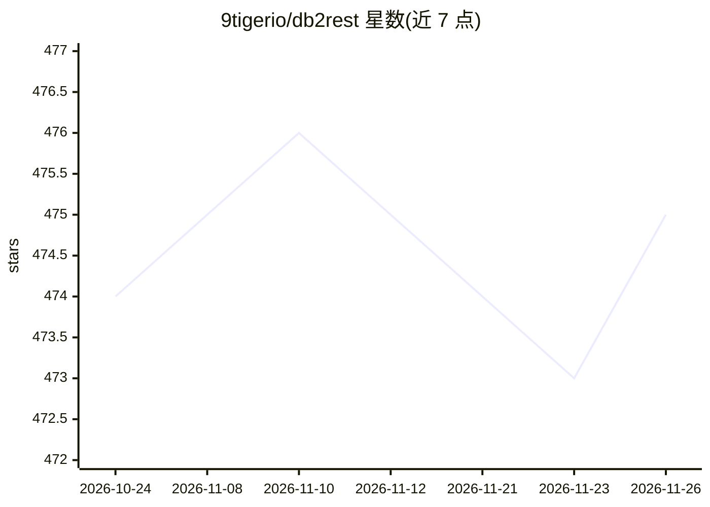

# 9tigerio/db2rest

⭐ 475 · Java · Apache-2.0 · 推送 2026-11-24 · [GitHub](https://github.com/9tigerio/db2rest) · [官网](https://db2rest.com) · 组织维护

**为关系数据库即时生成 REST 数据 API 的低代码平台**

DB2Rest 是一个低代码 REST 数据 API 平台，连接数据库后自动创建 REST API 端点，无需 ORM 与代码生成。支持 PostgreSQL、MySQL、Oracle（含 9i）、DB2、MariaDB 等 14 种数据库，定位为安全数据库网关以向内部开发者和伙伴开放数据，并可结合向量数据库与 LLM 提供上下文感知应用。通过 Docker 镜像或安装包分发，源码用 Maven 构建。

## 筛选速览

| 维度 | 判定 | 备注 |
|---|---|---|
| AI 角色 | `ai-enhanced` | 去掉 AI 部分产品仍成立 |
| 许可风险 | `permissive` | Apache-2.0 |
| 部署形态 | `self-host` | docker 或自建部署 |
| 模型依赖 | — | README 未给出锁定关系 |
| 硬件要求 | — | 无带数字的原话,不猜 |
| 安装摩擦 | `low` | 无编译、无系统依赖或容器化 |
| 成熟度 | — | 结构信号不足 |

## 能力要点

- 连接数据库后自动生成 REST API 端点，无需代码生成
- 支持 PostgreSQL/MySQL/Oracle/DB2/MariaDB 等 14 种数据库
- 作为安全数据库网关向内部开发者与伙伴开放数据
- 可与向量数据库和 LLM 配合构建 GenAI 应用

## 适用场景

- 为现有数据库快速暴露 REST API 供应用调用
- 为企业内部与合作伙伴提供安全的实时数据查询网关
- 替代 SFTP/S3 文件导出式的慢速数据交换流程
- 为 GenAI 应用的 function/tool 调用提供数据接口

## 场景标签

 · 领域:数据库/开发者工具

## 证据(README 行号)

> L1: DB2Rest is a modern low code REST DATA API platform that automatically creates a secure REST API endpoint
> L53: DB2Rest works hand in glove with modern vector databases and LLM implementations to provide consistent Web APIs to 

## 星数曲线

2026-10-24 474 → 2026-11-26 475（+1）

---
*卡片 v1 · prompt 1.4 · 生成 2026-11-25 · 置信度 high · 依据 README sha `d7e983d9dc85` · [字段定义](../../DATASET.md)*
