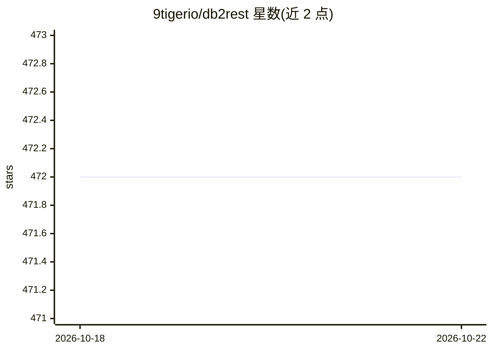

# 9tigerio/db2rest

⭐ 473 · Java · Apache-2.0 · 推送 2026-10-16 · [GitHub](https://github.com/9tigerio/db2rest) · [官网](https://db2rest.com) · 组织维护

**面向关系型数据库的无代码 REST DATA API 平台，可支撑 GenAI 应用**

DB2Rest 是低代码/无代码的 REST DATA API 平台：连接已有或新建数据库后自动生成 REST API 端点，无 ORM、无代码生成。支持 PostgreSQL、MySQL、Oracle（含 9i/10g）、IBM DB2、MariaDB、CockroachDB、Neon 等 14 种数据库及云托管版本。README 声明其可与语言模型（LM/LLM）及向量数据库结合，为 GenAI 应用提供一致的 Web API 供函数/工具调用，并可用作安全数据库网关。以 Docker 镜像与发布包形式提供，源码可用 Maven 构建。

## 筛选速览

| 维度 | 判定 | 备注 |
|---|---|---|
| AI 角色 | `ai-ecosystem` | LLM/agent 周边工具 |
| 许可风险 | `permissive` | Apache-2.0 |
| 部署形态 | `self-host` | docker 或自建部署 |
| 模型依赖 | — | README 未给出锁定关系 |
| 硬件要求 | — | 无带数字的原话,不猜 |
| 安装摩擦 | `low` | 无编译、无系统依赖或容器化 |
| 成熟度 | — | 结构信号不足 |

## 能力要点

- 自动生成 REST API 端点，无 ORM、无代码生成
- 支持 14 种数据库，含 Oracle 9i 专用版本与多个云托管数据库
- 声明可与 LLM 和向量数据库结合，为 GenAI 应用提供 Web API
- 可作为安全数据库网关对外开放数据

## 适用场景

- 不写后端代码即可为数据库生成 REST API
- 为 GenAI 应用的函数/工具调用提供数据访问接口
- 企业内部以数据库网关方式安全开放数据

## 场景标签

 · 领域:数据基础设施/API 平台

## 证据(README 行号)

> L4: It combines existing/new databases and data-sources with language models (LM/LLMs) and vector stores to rapidly
> L53: DB2Rest works hand in glove with modern vector databases and LLM implementations to provide consistent Web APIs to 

## 星数曲线

2026-10-18 472 → 2026-10-22 472（+0）

---
*卡片 v1 · prompt 1.4 · 生成 2026-10-21 · 置信度 mid · 依据 README sha `f793c3ec4882` · [字段定义](../../DATASET.md)*
