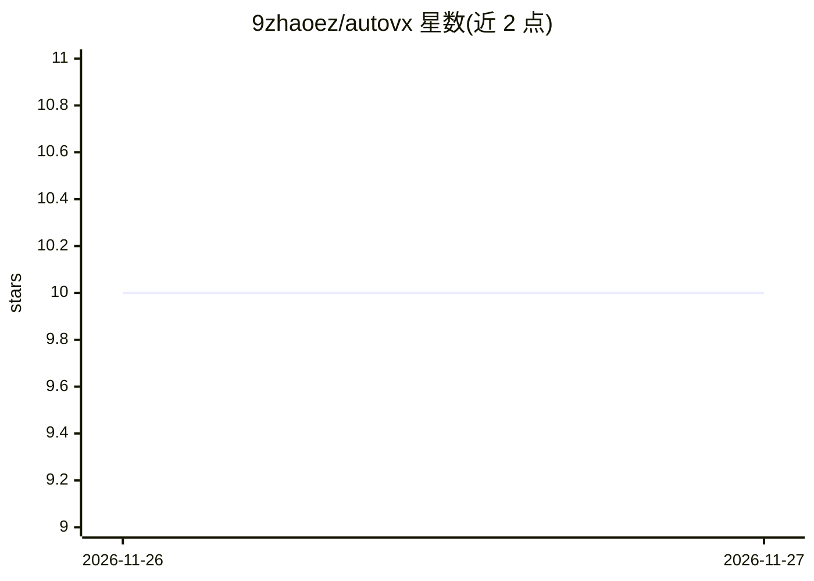

# 9zhaoez/autovx

⭐ 10 · Python · MIT · 推送 2026-06-08 · [GitHub](https://github.com/9zhaoez/autovx) · 个人维护 · 中文 README

**给微信用户自动回复消息的 OCR+AI 机器人**

通过屏幕截图、OCR 识字、AI 生成回复、模拟键盘输入的流程自动回复微信消息，不 hook 微信接口。基于 RapidOCR 读取消息，像素差分检测画面变化后才触发 OCR；支持关键词规则与 DeepSeek/OpenAI/Ollama/SiliconFlow 四种回复后端；SQLite 存对话记忆并提取对方信息，带 API 失败熔断和黑白名单。仅支持 Windows，依赖微信窗口可见，README 声明仅供学习研究。

## 筛选速览

| 维度 | 判定 | 备注 |
|---|---|---|
| AI 角色 | `ai-native` | 本体是模型或模型工具 |
| 许可风险 | `permissive` | MIT |
| 部署形态 | `library` | 以包/库形式分发 |
| 模型依赖 | local-ok | 支持本地模型 |
| 硬件要求 | — | 无带数字的原话,不猜 |
| 安装摩擦 | `low` | 无编译、无系统依赖或容器化 |
| 成熟度 | — | 结构信号不足 |

## 能力要点

- RapidOCR 截图识字，无需 hook 微信接口
- DeepSeek / OpenAI / Ollama / SiliconFlow 四种回复后端可选
- 像素差分实时监听，画面变化才触发 OCR
- SQLite 对话记忆、熔断保护与黑白名单

## 适用场景

- 微信收到大量重复消息时自动回复
- 挂机时让人工替代回复指定联系人
- 学习屏幕 OCR 加自动化操作的实现方式

## 场景标签

`聊天机器人` `OCR` `GUI 自动化` · 领域:效率与自动化

## 证据(README 行号)

> L9: 帮你自动回复微信消息的程序。屏幕截图 + OCR 识字 + AI 生成回复 + 模拟键盘打字，不需要 hook 微信任何接口，就像一个人真的坐在电脑前帮你回消息。
> L72: |🧠 AI 智能回复|DeepSeek / OpenAI / Ollama / SiliconFlow 四选一|

## 星数曲线

2026-11-26 10 → 2026-11-27 10（+0）

---
*卡片 v1 · prompt 1.4 · 生成 2026-11-26 · 置信度 high · 依据 README sha `093d7f09d2f0` · [字段定义](../../DATASET.md)*
