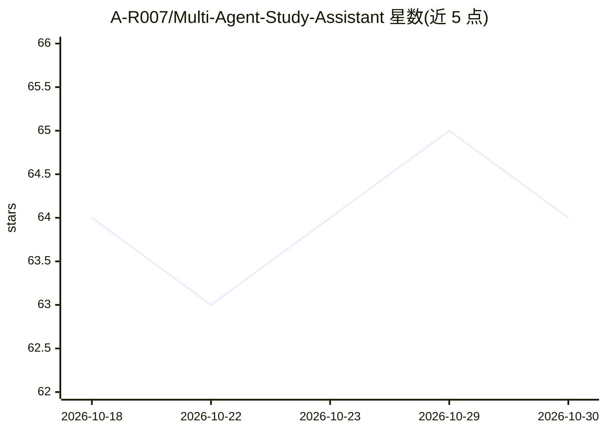

# A-R007/Multi-Agent-Study-Assistant

⭐ 64 · Python · 推送 2025-11-04 · [GitHub](https://github.com/A-R007/Multi-Agent-Study-Assistant) · 个人维护

**多智能体个性化学习平台：学习路线图、测验、辅导与文档问答**

面向学生的个性化学习 Web 应用，由 6 个专门化 AI agent 协作：学生分析、学习路线图生成、自适应测验生成、AI 辅导、资源查找和基于 RAG 的文档问答。用 Phidata 做多智能体编排，LangChain 与 ChromaDB 处理文档检索，LLM 由 OpenAI/Groq 提供，Streamlit 提供 Web 界面，DuckDuckGo 用于资源搜索。需配置 API key（.env），RAG 文档建议小于 50MB；本地以 streamlit run 启动。

## 筛选速览

| 维度 | 判定 | 备注 |
|---|---|---|
| AI 角色 | `ai-native` | 本体是模型或模型工具 |
| 许可风险 | `none` | — |
| 部署形态 | `library` | 以包/库形式分发 |
| 模型依赖 | locked-api |  |
| 硬件要求 | — | 无带数字的原话,不猜 |
| 安装摩擦 | `low` | 无编译、无系统依赖或容器化 |
| 成熟度 | — | 结构信号不足 |

## 能力要点

- 6 个专门化 agent：分析、路线图、测验、辅导、资源查找、RAG 问答
- RAG 文档问答：上传 PDF/讲义，回答附来源引用
- 按学习者类型（视觉/听觉/动觉/读写/混合）调整内容
- 多题型自适应测验并附答案解析

## 适用场景

- 生成按阶段与里程碑组织的个性化学习路线图
- 上传教材与笔记，基于自己的资料做问答
- 按知识水平自适应练习并获取讲解

## 场景标签

`多智能体` `文档问答` · 领域:Agent 开发

## 证据(README 行号)

> L46: study_agents.py          # Specialized AI agents (Analyzer, roadmap Creator, Quiz Generator, Tutor, Resource Finder
> L60: 6. **RAG Tutor Agent**: Answers questions using uploaded study documents

## 星数曲线

2026-10-18 64 → 2026-10-30 64（+0）

---
*卡片 v1 · prompt 1.4 · 生成 2026-10-24 · 置信度 high · 依据 README sha `39313f7f8d65` · [字段定义](../../DATASET.md)*
