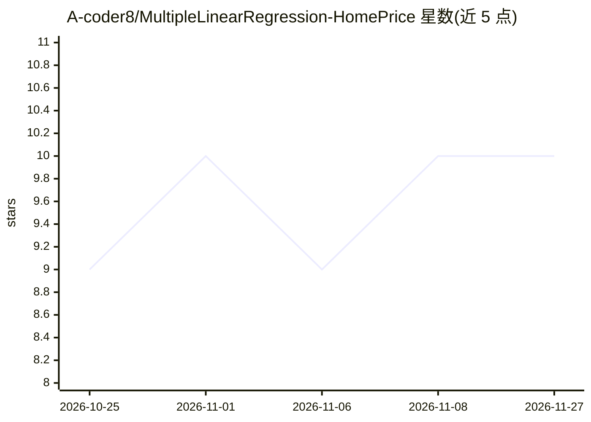

# A-coder8/MultipleLinearRegression-HomePrice

⭐ 10 · Python · 推送 2026-09-18 · [GitHub](https://github.com/A-coder8/MultipleLinearRegression-HomePrice) · 个人维护

**初学者练习项目：用多元线性回归预测房价**

使用 Python 与 Scikit-learn 实现多元线性回归预测房价的教学项目。模型读取 area、房间数、房龄、楼层、车位、电梯、仓库、地段评分等多个特征，用 CSV 数据集训练并做训练/测试集划分，以 R² 分数评估，并用 Matplotlib 绘制数据与预测关系对比图。数据集为自建合成数据，不代表真实房价。通过 pip 安装依赖后运行 main.py 即可执行。

## 筛选速览

| 维度 | 判定 | 备注 |
|---|---|---|
| AI 角色 | `ai-native` | 本体是模型或模型工具 |
| 许可风险 | `none` | — |
| 部署形态 | `library` | 以包/库形式分发 |
| 模型依赖 | — | README 未给出锁定关系 |
| 硬件要求 | — | 无带数字的原话,不猜 |
| 安装摩擦 | `low` | 无编译、无系统依赖或容器化 |
| 成熟度 | — | 结构信号不足 |

## 能力要点

- 多元线性回归预测房价，输入 8 个房屋特征
- CSV 数据集与训练/测试集划分
- R² 分数评估与 Matplotlib 可视化对比
- README 声明数据集为练习用合成数据

## 适用场景

- 练习用 Scikit-learn 做多元线性回归建模
- 学习 Pandas 数据处理与训练/测试划分流程
- 作为机器学习入门可视化案例参考

## 场景标签

`教程课程` · 领域:学习与行业

## 证据(README 行号)

> L3: A beginner-friendly machine learning project for predicting house prices using **Multiple Linear Regression**.
> L42: * Scikit-learn
> L80: The dataset used in this project is **synthetic data created for machine learning practice** and does not represent

## 星数曲线

2026-10-25 9 → 2026-11-27 10（+1）

---
*卡片 v1 · prompt 1.4 · 生成 2026-11-20 · 置信度 high · 依据 README sha `2d053e762bd4` · [字段定义](../../DATASET.md)*
