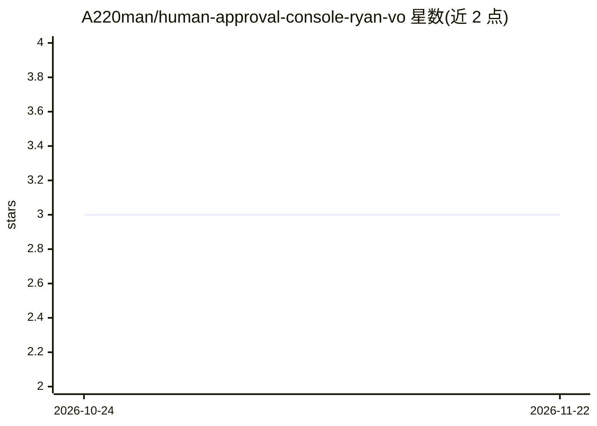

# A220man/human-approval-console-ryan-vo

⭐ — · [GitHub]() · 个人维护

**为 AI agent 高危操作提供人工审批与审计的治理控制台**

面向安全工程师、系统管理员与 AI 平台运营者的人工介入治理控制台：接收 agent 提议的操作（文件修改、数据库迁移、IAM 提权、资金支付等）进入持久队列，按影响/可逆性/资源关键性做多因子风险评分，执行正则策略护栏与 RBAC 审批（viewer/analyst/admin），审批回执经 HMAC-SHA256 签名并串联成哈希链以供防篡改验证。附带 22 条标注样本的评测基准与指标输出；LLM 咨询解释为可选项，未配置 API key 时自动启用离线确定性引擎。

## 筛选速览

| 维度 | 判定 | 备注 |
|---|---|---|
| AI 角色 | `ai-enhanced` | 去掉 AI 部分产品仍成立 |
| 许可风险 | `permissive` | — |
| 部署形态 | `self-host` | docker 或自建部署 |
| 模型依赖 | local-ok | 支持本地模型 |
| 硬件要求 | — | 无带数字的原话,不猜 |
| 安装摩擦 | `low` | 无编译、无系统依赖或容器化 |
| 成熟度 | `idea` | |

## 能力要点

- 多因子风险评分（影响/可逆性/资源关键性）生成四级复合评级
- HMAC-SHA256 签名回执与 prev_receipt_hash 哈希链，内置验证端点
- RBAC 三级角色与 MODIFY_AND_APPROVE 改参后重评分机制
- 自带 22 样本、5 类别的可复现评测基准（CLI 与 API 两种运行方式）

## 适用场景

- 审批 agent 提议的数据库迁移、IAM 提权或资金操作
- 为 agent 操作建立签名回执与不可篡改审计链
- 在无外部 LLM key 的环境下运行确定性风险策略评测

## 场景标签

`模型评测` · 领域:评测与运维

## 证据(README 行号)

> L7: Autonomous AI agents executing tool calls, database operations, infrastructure scripts, and financial transactions r
> L71:  - Includes a **deterministic offline engine** that activates automatically when `LLM_API_KEY` is not provided, ens

## 星数曲线

2026-10-24 3 → 2026-11-22 3（+0）

---
*卡片 v1 · prompt 1.4 · 生成 2026-11-22 · 置信度 high · 依据 README sha `6f808117a9e5` · [字段定义](../../DATASET.md)*
