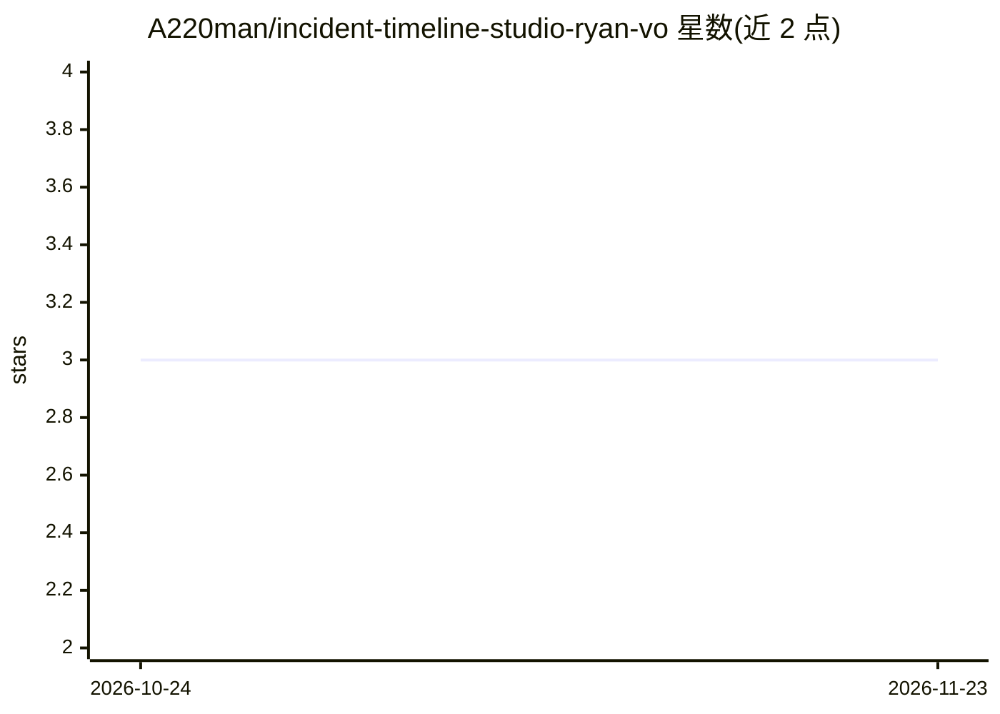

# A220man/incident-timeline-studio-ryan-vo

⭐ 3 · Python · MIT · 推送 2026-11-19 · [GitHub](https://github.com/A220man/incident-timeline-studio-ryan-vo) · 个人维护

**给安全分析师把混合 CSV/JSON 日志整理成可审查的 UTC 事件时间线**

Incident Timeline Studio 将 CSV、JSON 数组/行式日志导入并规范化为 UTC 时间线：支持显式时区偏移与 epoch 时间戳解析、基于实体的时间关联、事件速率统计（MAD 方法）、去重与导入回执、审查标注与 CSV/JSON 导出。后端 FastAPI + SQLite，前端 React + TypeScript，生产环境使用 OIDC PKCE 登录与角色权限。LLM 建议为可选项，仅发送聚合统计量，回答须引用证据类别，失败时回退到本地确定性建议。导入限制 5 MiB/10,000 行，单事件上限 10,000 条。

## 筛选速览

| 维度 | 判定 | 备注 |
|---|---|---|
| AI 角色 | `ai-enhanced` | 去掉 AI 部分产品仍成立 |
| 许可风险 | `permissive` | MIT |
| 部署形态 | `self-host` | docker 或自建部署 |
| 模型依赖 | local-ok | 支持本地模型 |
| 硬件要求 | — | 无带数字的原话,不猜 |
| 安装摩擦 | `low` | 无编译、无系统依赖或容器化 |
| 成熟度 | `idea` | |

## 能力要点

- 多格式时间戳规范化：显式偏移、IANA 时区、epoch 秒/毫秒，歧义 DST 时间直接拒绝
- 基于实体的时间关联与事件速率异常检测，含可复现合成基准（种子 17–28 训练/10017–10028 评估）
- 可选用外部 LLM 建议：仅传输聚合计数与时序测量，响应须引用证据类别，否则回退本地建议
- OIDC 授权码 + S256 PKCE 登录、HttpOnly 会话 Cookie、CSRF 令牌与 Viewer/Reviewer/Admin 三级角色

## 适用场景

- 把多来源 CSV/JSON 事件日志合并成统一 UTC 时间线审查
- 标记事件相关性并记录审查理由后导出给同事或报告
- 通过 OIDC/Keycloak 接入企业 SSO 的共享安全分析工作区
- 运行合成基准评估时间关联窗口参数

## 场景标签

`网络安全` · 领域:学习与行业

## 证据(README 行号)

> L7: Incident Timeline Studio helps security analysts turn mixed CSV and JSON logs into a reviewable UTC timeline. It com
> L101: No LLM key is needed for core workflows. `LLM_API_KEY` is the one LLM credential; `LLM_PROVIDER`, `LLM_MODEL`, and
> L110: External requests happen only when a reviewer clicks **Request external advice**. Only aggregate counts and timing

## 星数曲线

2026-10-24 3 → 2026-11-23 3（+0）

---
*卡片 v1 · prompt 1.4 · 生成 2026-11-22 · 置信度 high · 依据 README sha `d82bddd1cee0` · [字段定义](../../DATASET.md)*
