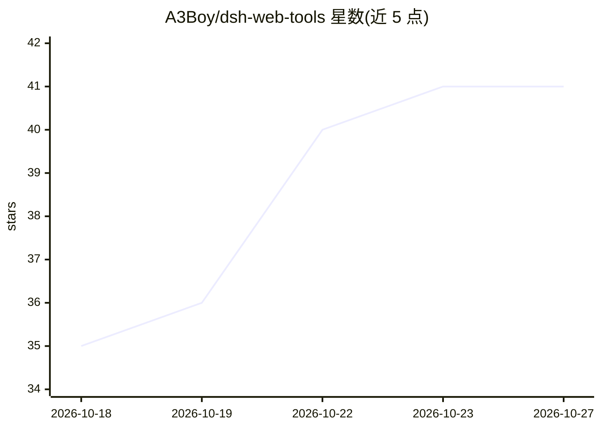

# A3Boy/dsh-web-tools

⭐ 41 · JavaScript · MIT · 推送 2026-10-25 · [GitHub](https://github.com/A3Boy/dsh-web-tools) · 个人维护 · 中文 README

**DeepSeek Harness 的多源网页搜索与抓取插件（8 搜索源+小红书/X）**

面向 DeepSeek Harness（DSH）Agent 的 web_search / web_fetch 工具插件：将 Exa、Tavily、Firecrawl、Parallel、Brave、You.com、Jina、SearXNG 八个搜索源接入统一工具接口，通过 SearchHints 用确定性代码把统一搜索意图编译为各提供方原生参数（类目、时间、地域、域名约束），不做额外 LLM 调用。含多 Key 池、401/429 故障切换与路由策略；另通过本地浏览器专属 Profile（CDP 控制 Edge/Chrome）实现小红书与 Twitter/X 登录态原生搜索、详情与评论抓取。支持自定义搜索提供方与声明式 JSON 映射，内置 SSRF 防护；对图片为主的笔记不做 OCR。

## 筛选速览

| 维度 | 判定 | 备注 |
|---|---|---|
| AI 角色 | `ai-ecosystem` | LLM/agent 周边工具 |
| 许可风险 | `permissive` | MIT |
| 部署形态 | `library` | 以包/库形式分发 |
| 模型依赖 | locked-api |  |
| 硬件要求 | — | 无带数字的原话,不猜 |
| 安装摩擦 | `low` | 无编译、无系统依赖或容器化 |
| 成熟度 | — | 结构信号不足 |

## 能力要点

- 8 个搜索提供方的原生参数适配（SearchHints 确定性编译，无额外 LLM 延迟）
- 小红书与 Twitter/X 登录态原生搜索、详情与评论抓取（专属浏览器 Profile + CDP）
- 多 Key 池、429 冷却、401 故障切换与 Ordered/Round-Robin/Random 路由
- 自定义搜索提供方声明式映射与 SSRF/DNS 出站防护

## 适用场景

- 为 DSH Agent 提供多搜索源冗余的 web_search/web_fetch 能力
- 让 Agent 检索小红书和 Twitter/X 的原生内容与评论
- 接入自建 SearXNG 或自定义内部搜索接口作为搜索后端

## 场景标签

`网页抓取` · 领域:效率与自动化

## 证据(README 行号)

> L26: dsh-web-tools connects Exa, Tavily, Firecrawl, Parallel, Brave, You.com, Jina, SearXNG, Xiaohongshu, and Twitter / 
> L36: - **Native DSH Tool Integration**: Plugs directly into standard `web_search` / `web_fetch` without requiring new to
> L5: Empower DeepSeek Harness with unified search and deep content extraction across the open web and social platforms.

## 星数曲线

2026-10-18 35 → 2026-10-27 41（+6）

---
*卡片 v1 · prompt 1.4 · 生成 2026-10-25 · 置信度 high · 依据 README sha `6552c8dc132b` · [字段定义](../../DATASET.md)*
