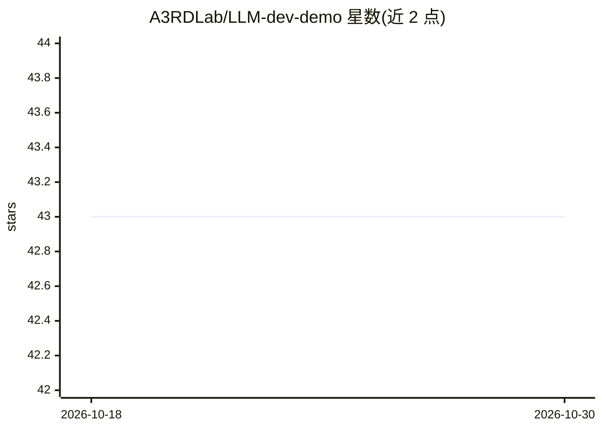

# A3RDLab/LLM-dev-demo

⭐ 43 · Jupyter Notebook · Apache-2.0 · 推送 2026-08-23 · [GitHub](https://github.com/A3RDLab/LLM-dev-demo) · 组织维护 · 中文 README

**LLM 应用开发教程实验合集：Agent/RAG/MCP/Text2SQL 示例**

由 A³ R&D Lab 维护的大模型应用开发系列示例，覆盖基础调用、结构化输出、function calling 与 Agent 编排（LangGraph、DeepAgents、MCP 协议）、自包含 RAG、Text2SQL 及金融文档审核完整项目。提供引导式实验手册与配套讲义，所有脚本支持 --model/--api_key/--base_url 参数切换模型与平台（默认硅基流动）。过时写法移入 archive/ 并附归档原因。原创代码采用 Apache-2.0，第三方材料保留原权利状态。

## 筛选速览

| 维度 | 判定 | 备注 |
|---|---|---|
| AI 角色 | `ai-knowledge` | 知识聚合/清单类 |
| 许可风险 | `permissive` | Apache-2.0 |
| 部署形态 | `library` | 以包/库形式分发 |
| 模型依赖 | — | README 未给出锁定关系 |
| 硬件要求 | — | 无带数字的原话,不猜 |
| 安装摩擦 | `low` | 无编译、无系统依赖或容器化 |
| 成熟度 | — | 结构信号不足 |

## 能力要点

- 覆盖基础调用→Agent 编排→RAG→Text2SQL 的分阶段示例
- 自包含 RAG 全链路（切块→embedding→余弦检索→生成，索引缓存）
- FastMCP 服务端 + Streamable HTTP 客户端 agent 示例
- 全部脚本支持参数切换模型与平台，实验手册命令经实机验证

## 适用场景

- 系统学习 LLM 应用开发并动手跑通示例
- 参考 function calling、MCP、Agent Harness 的实现写法
- 复用金融文档审核等生产风格项目模板

## 场景标签

`教程课程` `RAG` `数据分析` · 领域:效率与自动化

## 证据(README 行号)

> L3: 大模型应用开发的系列示例，覆盖从基础调用到 Agent 编排的完整学习路线。
> L31: ### Agent / Function Calling（推荐学习顺序）

## 星数曲线

2026-10-18 43 → 2026-10-30 43（+0）

---
*卡片 v1 · prompt 1.4 · 生成 2026-10-25 · 置信度 mid · 依据 README sha `3668d1d6eefd` · [字段定义](../../DATASET.md)*
