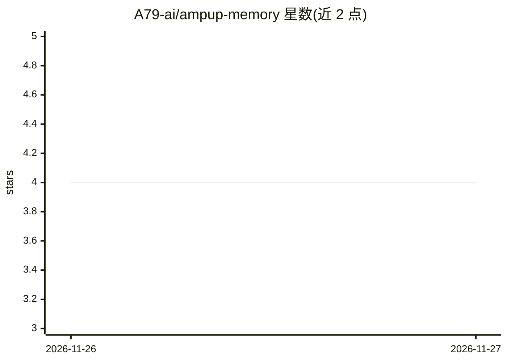

# A79-ai/ampup-memory

⭐ 4 · Rust · Apache-2.0 · 推送 2026-11-26 · [GitHub](https://github.com/A79-ai/ampup-memory) · [官网](https://www.ampup.ai/ampup-memory) · 组织维护

**给 AI agent 用的记忆库：从成功运行中学习建议并在下次运行前提供**

面向 AI agent 的记忆系统：会话中每个任务通过 get_advice 获取一条针对该类任务的建议（来自此前有奖励的运行，或从文档编译的流程）；会话结束后按结果判定/奖励，有奖励的会话用于教导后续会话。底层为带引用的记忆：笔记、文档与对话变成可检索的段落与事实，每条事实引用其来源并按权限可见。数据以 Apache Iceberg 表存储在用户自管的 catalog 和 bucket 中。以 Rust 编写的 server/CLI 形式提供，经 PyPI、安装脚本或源码构建安装，支持 MCP、HTTP API 与 Python/TypeScript 客户端。

## 筛选速览

| 维度 | 判定 | 备注 |
|---|---|---|
| AI 角色 | `ai-ecosystem` | LLM/agent 周边工具 |
| 许可风险 | `permissive` | Apache-2.0 |
| 部署形态 | `library` | 以包/库形式分发 |
| 模型依赖 | local-ok | 支持本地模型 |
| 硬件要求 | — | 无带数字的原话,不猜 |
| 安装摩擦 | `low` | 无编译、无系统依赖或容器化 |
| 成熟度 | — | 结构信号不足 |

## 能力要点

- 从有奖励的运行中学习建议，下次同类任务前提供
- 带引用的记忆：每条事实注明来源并按读取权限过滤
- 数据存为 Apache Iceberg 表，catalog 与 bucket 由用户自管
- 提供 MCP 端点、HTTP 路由与 Python/TypeScript SDK

## 适用场景

- 让 coding agent 在会话开始前获取此前积累的任务建议
- 记录并检索团队笔记、文档、GitHub/Linear/Sentry/Slack 数据
- 离线环境下用本地嵌入与 Ollama 模型运行记忆服务

## 场景标签

`Agent 记忆` `知识库管理` · 领域:Agent 开发

## 证据(README 行号)

> L3: The memory for agents that gets better with use: it learns advice from the runs that went well and serves it
> L9: A conversation is a session. Each task in it asks for advice (`get_advice`) and gets one skill for that kind of
> L71: searches but learns nothing; any OpenAI-compatible, Anthropic, Bedrock or Vertex AI endpoint, or a local Ollama,

## 星数曲线

2026-11-26 4 → 2026-11-27 4（+0）

---
*卡片 v1 · prompt 1.4 · 生成 2026-11-26 · 置信度 high · 依据 README sha `4732955f9121` · [字段定义](../../DATASET.md)*
