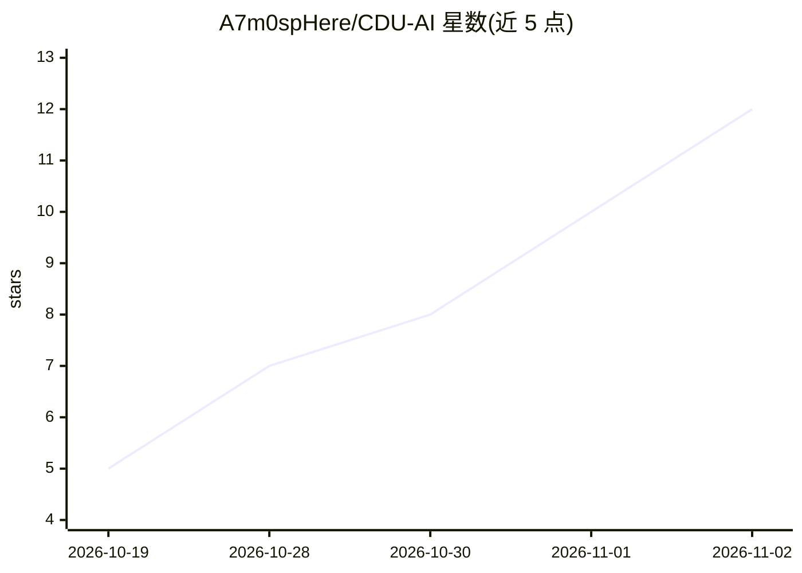

# A7m0spHere/CDU-AI

⭐ 12 · TypeScript · MIT · 推送 2026-11-01 · [GitHub](https://github.com/A7m0spHere/CDU-AI) · [官网](wiki.cduai.top) · 组织维护 · 中文 README

**面向成都大学同学的开放 AI 学习站与共建指南**

由成都大学计算机协会 AI 方向发起的学生社区学习站（非学校官方），基于 Astro 5 + TypeScript 的静态站点，提供 AI 入门指南、按用途组织的工具与社区资源目录、带校园示例的分类术语表，以及站内搜索和主题定制。当前处于 M0 开发中，账号、论坛、投稿表单等尚未开放，作品广场为空。站点本身不调用大模型服务，支持表单与 GitHub 网页参与共建，AI 仅用于辅助内容起草与初审，最终由审核负责人确认。

## 筛选速览

| 维度 | 判定 | 备注 |
|---|---|---|
| AI 角色 | `ai-knowledge` | 知识聚合/清单类 |
| 许可风险 | `permissive` | MIT |
| 部署形态 | `None` |  |
| 模型依赖 | — | README 未给出锁定关系 |
| 硬件要求 | — | 无带数字的原话,不猜 |
| 安装摩擦 | `low` | 无编译、无系统依赖或容器化 |
| 成熟度 | `idea` | |

## 能力要点

- 按用途组织的工具资源目录，含 OCR 独立栏目与 AIGC 工作流
- AI 术语表按主分支/延伸分支分类，含来源与校园示例
- 站内搜索支持 Ctrl/Cmd+K 快捷键与键盘操作
- 静态站点，无需数据库或模型 API Key

## 适用场景

- 作为大学生查找 AI 入门学习路径与工具
- 查阅带校园示例的 AI 术语解释
- 通过纠错或经验投稿参与社区共建

## 场景标签

`教程课程` `精选清单` · 领域:学习与行业

## 证据(README 行号)

> L5: 面向成都大学全校同学的开放 AI 学习站与共建项目。先从一个具体问题出发，找到合适的工具，再把可复现的做法整理成指南。
> L7: 由成都大学计算机协会 AI 方向发起，**非学校官方平台**。
> L22: - **工具资源**：按主要用途组织工具、项目与社区资源，OCR 独立成栏，AIGC 包含设计、演示、文档和创作工作流；支持栏目内搜索、能力筛选和手机全目录分页，更多开源 Agent 默认折叠，暂不收录独立模型。
> L23: - **AI 术语表**：已按 AI 主分支与延伸分支建设分类词条，包含来源、校园示例和相关词入口。不同批次的审核范围与方式分别记录，见文档导航，不将 AI 初审等同于人工二审。

## 星数曲线

2026-10-19 5 → 2026-11-02 12（+7）

---
*卡片 v1 · prompt 1.4 · 生成 2026-11-02 · 置信度 high · 依据 README sha `0167f3120e1a` · [字段定义](../../DATASET.md)*
