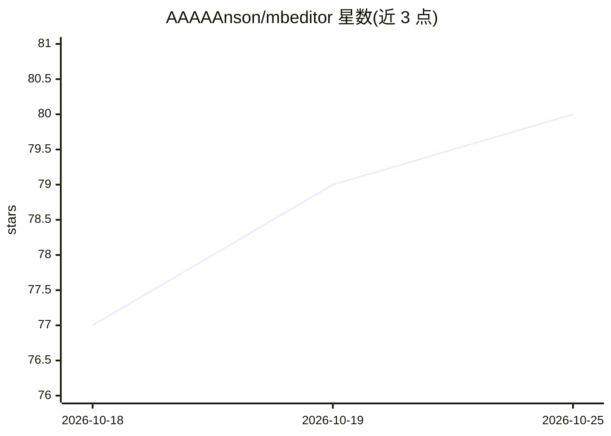

# AAAAAnson/mbeditor

⭐ 80 · TypeScript · MIT · 推送 2026-07-08 · [GitHub](https://github.com/AAAAAnson/mbeditor) · 个人维护 · 中文 README

**自托管 AI 微信公众号编辑器：一句话生成排版好的推文**

面向公众号作者的自托管写作与排版工具：在起稿台输入一句话，AI（BYOK，如 DeepSeek，key 仅存本地）流式生成整篇排版好的推文，支持五套按调子划分的版式模板；可对话式改稿、选中润色，块级增量更新且改写不丢图片/SVG。编辑器提供所见即所得、Markdown、HTML 三种模式，带版本历史与回收站，可一键复制富文本或推送微信草稿箱并自动上传图片到微信 CDN。每个功能均为 REST API 端点，附带 Typer CLI 与 Skill 文件，Claude Code / Codex / OpenClaw 等 Agent 可直接操控。通过 Docker Compose 一键部署，前端 React 19，后端 FastAPI。

## 筛选速览

| 维度 | 判定 | 备注 |
|---|---|---|
| AI 角色 | `ai-native` | 本体是模型或模型工具 |
| 许可风险 | `permissive` | MIT |
| 部署形态 | `self-host` | docker 或自建部署 |
| 模型依赖 | locked-api |  |
| 硬件要求 | — | 无带数字的原话,不猜 |
| 安装摩擦 | `low` | 无编译、无系统依赖或容器化 |
| 成熟度 | — | 结构信号不足 |

## 能力要点

- 一句话流式生成整篇排版推文，五套排版调子模板
- BYOK 模式，API key 只存本地后端具名卷
- 完整 RESTful API + Typer CLI + Skill 文件，Agent 可全程操控无需浏览器
- 版本历史、软删回收站、AI 改写媒体守恒（图片/SVG 不丢失）

## 适用场景

- 我想让 AI 帮我把一个想法直接写成排版好看的公众号推文
- 我想让 Claude Code 等 Agent 定时批量生成推文并推到草稿箱
- 我想在公众号样式下所见即所得地编辑并一键发布

## 场景标签

`AI 写作` · 领域:内容生成

## 证据(README 行号)

> L5: **说一句你的想法，AI 帮你写出一篇好看的推文。**
> L19: MBEditor 想让这件事变简单:**输入一句话，AI 流式生成一整篇排版好看的推文，预览即所得，一键存草稿。** 模型自带（BYOK，如 DeepSeek）——你的 API key 只存在自己的机器上，不经过任何第三方。
> L29: 输入一个主题，AI 流式生成整篇排版好的推文。按「调子」分派多套结构性不同的版式，不是只换配色。模型自带（BYOK），key 只存本地。

## 星数曲线

2026-10-18 77 → 2026-10-25 80（+3）

---
*卡片 v1 · prompt 1.4 · 生成 2026-10-24 · 置信度 mid · 依据 README sha `38808327e445` · [字段定义](../../DATASET.md)*
