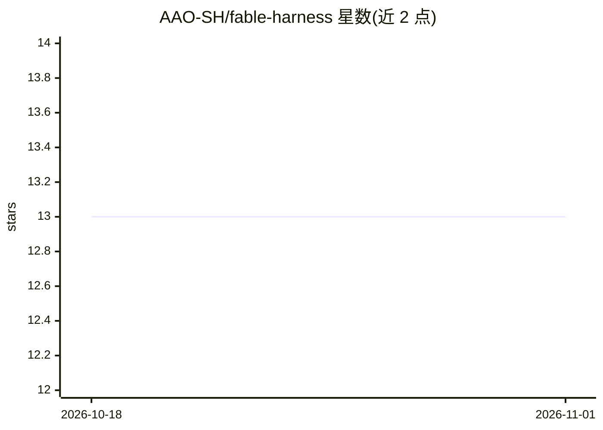

# AAO-SH/fable-harness

⭐ 13 · Python · MIT · 推送 2026-06-28 · [GitHub](https://github.com/AAO-SH/fable-harness) · [官网](https://fable.aao.sh) · 组织维护

**给 AI 编码 agent 安装的项目本地记忆/规划/验证/回滚控制层**

面向 Codex、Claude Code 及兼容 agent 的项目内 harness 技能：通过 npx 或 Python 安装器向工作区写入指令文件并部署控制层。提供五个主工作流——语义记忆与决策留痕、基于项目证据的规划、定向-检查-决策-行动-验证-报告的决策循环、独立域并行子代理、选择性回滚（检查点/备份/反向补丁）。需要 Python 3.9+，npm 入口底层仍运行 Python。由 AAO.sh 社区维护，MIT 许可。

## 筛选速览

| 维度 | 判定 | 备注 |
|---|---|---|
| AI 角色 | `ai-ecosystem` | LLM/agent 周边工具 |
| 许可风险 | `permissive` | MIT |
| 部署形态 | `library` | 以包/库形式分发 |
| 模型依赖 | — | README 未给出锁定关系 |
| 硬件要求 | — | 无带数字的原话,不猜 |
| 安装摩擦 | `low` | 无编译、无系统依赖或容器化 |
| 成熟度 | — | 结构信号不足 |

## 能力要点

- 项目本地语义记忆：决策留痕、记忆分片、RAG 与图检索
- 原生决策循环记录事件、检查清单证据、子代理波次与闭环状态
- 选择性回滚：生成回滚计划、检查点、备份与反向补丁
- 支持 codex/claude/any/both/auto 五种 agent 安装目标

## 适用场景

- 让编码 agent 在项目内持久记住决策并可重载上下文
- 对变更类任务保留可审计的决策痕迹与验证证据
- 并行执行跨文件/跨域任务且不破坏生成状态
- 精确撤销单个文件或某次 agent 改动

## 场景标签

`Agent 记忆` `Agent 框架` · 领域:Agent 开发

## 证据(README 行号)

> L27: Fable Harness installs a project-local control layer for AI coding agents. It gives Codex, Claude Code, and compati
> L105: - A native decision loop: orient, inspect, decide, act, verify, report.

## 星数曲线

2026-10-18 13 → 2026-11-01 13（+0）

---
*卡片 v1 · prompt 1.4 · 生成 2026-10-31 · 置信度 mid · 依据 README sha `5d2ac3ea2765` · [字段定义](../../DATASET.md)*
