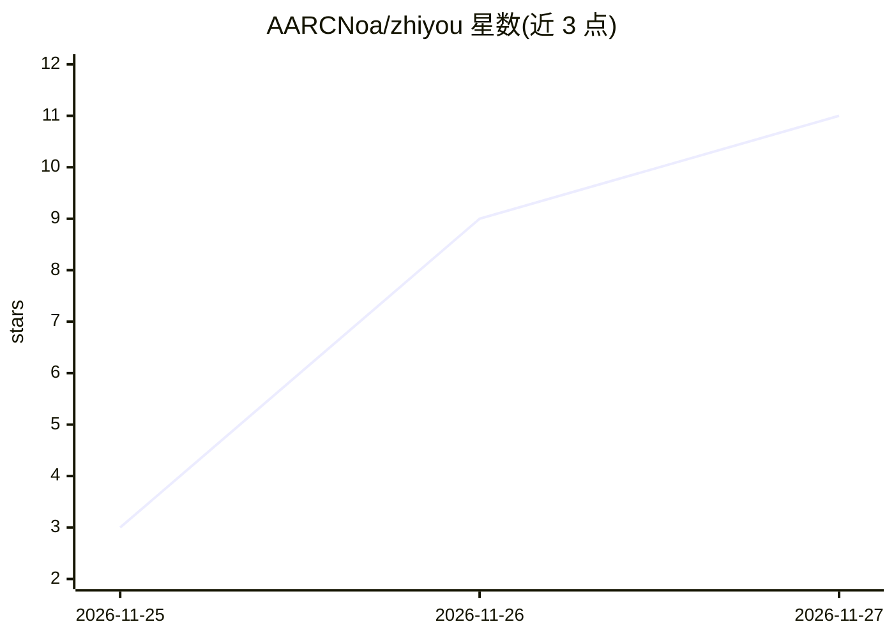

# AARCNoa/zhiyou

⭐ 11 · Kotlin · GPL-3.0 · 推送 2026-11-24 · [GitHub](https://github.com/AARCNoa/zhiyou) · 个人维护 · 中文 README

**给微信加 AI 好友记忆与群聊摘要的 LSPosed 模块**

跑在 LSPosed 上的微信增强模块，本仓库是 wcx 的二次开发。AI 功能含三块：好友档案（标签、带时间的记忆、关键事件、人格侧写，AI 读取聊天历史自动整理，审查确认后写入）、智能建议与自动回复（拟候选回复、对方来消息静默后自动回）、群聊摘要（按 1~168 小时频率压成标题+要点+待办）。AI 配置兼容 OpenAI 格式的 API，数据只存本机。需 root 手机与 LSPosed，适配微信 8.0.79，其余功能为 239 项常规增强开关。

## 筛选速览

| 维度 | 判定 | 备注 |
|---|---|---|
| AI 角色 | `ai-enhanced` | 去掉 AI 部分产品仍成立 |
| 许可风险 | `viral` | GPL-3.0 |
| 部署形态 | `None` |  |
| 模型依赖 | — | README 未给出锁定关系 |
| 硬件要求 | — | 无带数字的原话,不猜 |
| 安装摩擦 | `low` | 无编译、无系统依赖或容器化 |
| 成熟度 | — | 结构信号不足 |

## 能力要点

- 好友档案：AI 读取聊天历史生成标签、带时间记忆与人格侧写，审查确认后写入
- 智能建议与自动回复：聊天页双击出候选回复；自动回复可被自己发消息立即作废
- 群聊摘要按设定频率生成「一句话标题 + 要点 + 待办」，首页红点提醒
- 239 个常规增强开关与 43 项后台服务，API + MCP 服务器

## 适用场景

- 想记住好友的工作、爱好和答应过的事，不用翻聊天记录
- 消息堆着没回时用智能建议或自动回复
- 群消息太多，只想定时看有没有正事和待办

## 场景标签

`AI 助手` · 领域:对话与助手

## 证据(README 行号)

> L3: > 本项目是 wcx 的二次开发，一个跑在 LSPosed 上的微信增强模块。
> L9: - **好友档案** —— 标签、带时间的记忆、关键事件、人格侧写；配智能建议与自动回复。
> L99: 2. 打开 `微信 → 我 → 设置 → 知友`，主页的 AI 卡片点「配置」，填 **API 地址 / Key / 模型名称**。

## 星数曲线

2026-11-25 3 → 2026-11-27 11（+8）

---
*卡片 v1 · prompt 1.4 · 生成 2026-11-24 · 置信度 high · 依据 README sha `2e0f187c5d01` · [字段定义](../../DATASET.md)*
