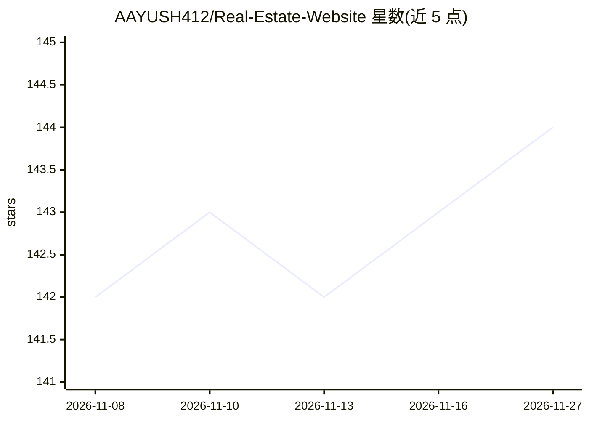

# AAYUSH412/Real-Estate-Website

⭐ 144 · TypeScript · MIT · 推送 2026-11-05 · [GitHub](https://github.com/AAYUSH412/Real-Estate-Website) · [官网](https://buildestate.vercel.app) · 个人维护

**面向印度市场的房产网站+管理面板，附带 AI 房源搜索**

基于 MERN 与 TypeScript 的房产列表平台：公开网站供浏览房源、预约看房、提交待审核房源；独立管理面板负责房源/用户/预约审核；AI Property Hub 通过 Firecrawl 抓取 99acres、MagicBricks 等 4 个门户的实时房源，用 NVIDIA 托管模型打分与标记关注点并展示区域价格趋势。AI 搜索为可选功能（需 NVIDIA 与 Firecrawl key），本地一条命令运行，自动下载 MongoDB。面向学生与学习 MERN 的开发者。限制：管理面板仅支持桌面屏幕，AI 结果依赖第三方站点。

## 筛选速览

| 维度 | 判定 | 备注 |
|---|---|---|
| AI 角色 | `ai-enhanced` | 去掉 AI 部分产品仍成立 |
| 许可风险 | `permissive` | MIT |
| 部署形态 | `None` |  |
| 模型依赖 | — | README 未给出锁定关系 |
| 硬件要求 | — | 无带数字的原话,不猜 |
| 安装摩擦 | `low` | 无编译、无系统依赖或容器化 |
| 成熟度 | — | 结构信号不足 |

## 能力要点

- Firecrawl 抓取 4 个印度房产门户的实时房源
- NVIDIA 托管 AI 模型对房源打分并标记关注点
- 三条命令本地启动（Node 22.12+，自动下载 MongoDB）
- 135 个自动化测试，CI 在三平台跑 README 快速开始流程

## 适用场景

- 学习完整 MERN 应用（登录、事务、审计日志、部署）
- 作为毕业设计或全栈课程项目基础
- 搭建一个可运行房产列表网站起点并扩展

## 场景标签

 · 领域:房地产/全栈 Web 应用

## 证据(README 行号)

> L19: BuildEstate is a real estate web application for the Indian property market. People can browse homes, book viewings
> L59: - Finds live listings through Firecrawl from 99acres, MagicBricks, Housing.com and NoBroker
> L64: AI output can be wrong, so treat it as a starting point and not as investment advice. To protect API credits, a pub

## 星数曲线

2026-11-08 142 → 2026-11-27 144（+2）

---
*卡片 v1 · prompt 1.4 · 生成 2026-11-17 · 置信度 high · 依据 README sha `f7a7ab105baf` · [字段定义](../../DATASET.md)*
