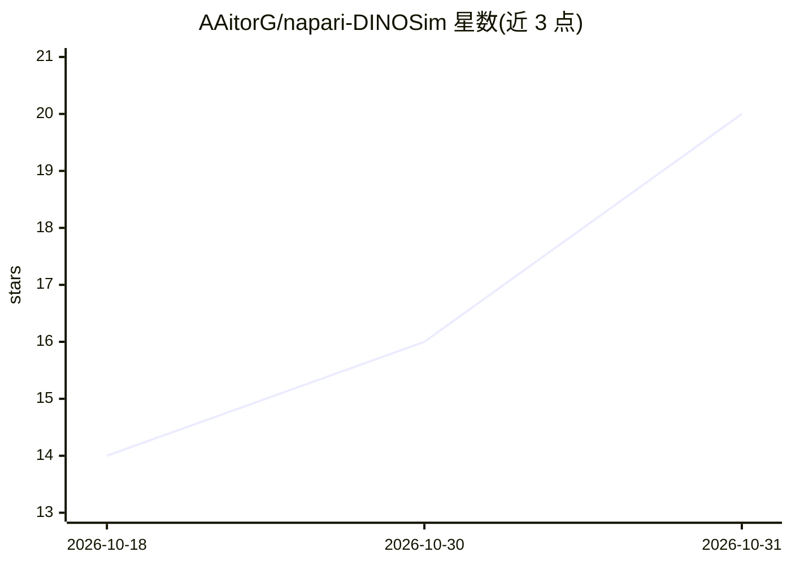

# AAitorG/napari-DINOSim

⭐ 20 · Python · MIT · 推送 2026-10-30 · [GitHub](https://github.com/AAitorG/napari-DINOSim) · 组织维护

**基于 DINOv2 的零样本显微图像分割 napari 插件**

napari 插件，利用预训练 DINOv2 视觉变换器做零样本图像分割：用户在图像上选取参考点，插件计算 patch 相似度图并生成分割掩膜，可检测并分割复杂数据集中未见过的目标，无需训练。面向生物显微图像分析研究者，提供 napari 图形界面与可编程调用的示例 notebook，支持嵌入式的加载/保存。通过 pip 或从源码（conda）安装；无 CUDA 时自动回退到 CPU 或 Apple MPS。

## 筛选速览

| 维度 | 判定 | 备注 |
|---|---|---|
| AI 角色 | `ai-native` | 本体是模型或模型工具 |
| 许可风险 | `permissive` | MIT |
| 部署形态 | `library` | 以包/库形式分发 |
| 模型依赖 | — | README 未给出锁定关系 |
| 硬件要求 | — | 无带数字的原话,不猜 |
| 安装摩擦 | `medium` | 含编译或系统依赖之一 |
| 成熟度 | — | 结构信号不足 |

## 能力要点

- 选取参考点即可零样本分割未见目标，无需训练
- 基于 DINOv2 预训练嵌入计算 patch 相似度图
- 提供 napari 界面操作与程序化使用的示例 notebook
- 无 CUDA 环境自动回退 CPU / Apple MPS

## 适用场景

- 在显微图像上通过点击参考点分割稀有或未见过的目标
- 在 napari 中交互式生成分割掩膜
- 程序化加载/保存嵌入与参考做批量分析

## 场景标签

`目标检测` `图像视频处理` · 领域:感知与多模态

## 证据(README 行号)

> L12: A [napari] plugin for zero-shot image segmentation using DINOv2 vision transformers.
> L16: `napari-DINOSim` enables zero-shot image segmentation by selecting reference points on an image. The plugin leverag

## 星数曲线

2026-10-18 14 → 2026-10-31 20（+6）

---
*卡片 v1 · prompt 1.4 · 生成 2026-10-30 · 置信度 high · 依据 README sha `b0590d6df295` · [字段定义](../../DATASET.md)*
