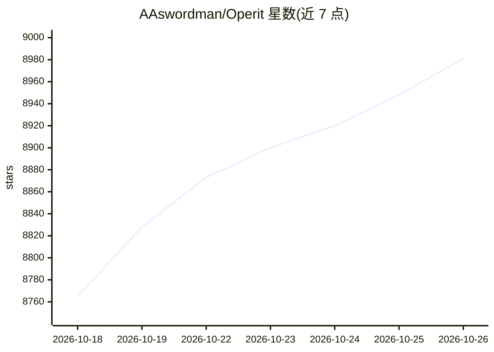

# AAswordman/Operit

⭐ 8,981 · Kotlin · LGPL-3.0 · 推送 2026-10-05 · [GitHub](https://github.com/AAswordman/Operit) · [官网](https://operit.app) · 个人维护 · 中文 README

**Android 开源 AI Agent 与 AI 聊天平台，连接系统能力执行真实任务**

面向 Android 用户的开源 AI Agent 平台：接入云端模型（OpenAI/Anthropic/Gemini 及兼容端点、key 池）或本地推理（内置 MNN、经 llama.cpp 运行 GGUF、Ollama/LM Studio），通过工具调用、MCP、ToolPkg、Skills 与工作流连接系统能力、终端、内置浏览器与文件，执行信息检索、文件处理、代码开发与设备自动化等任务。附图谱长期记忆、多角色聊天、扩展市场、语音与虚拟形象。要求 Android 8.0+ 与 ARM64 设备，以 Releases 页 APK 安装；本地不托管推理，云端请求直连用户配置的服务商。另有跨平台后继项目 Operit 2。

## 筛选速览

| 维度 | 判定 | 备注 |
|---|---|---|
| AI 角色 | `ai-native` | 本体是模型或模型工具 |
| 许可风险 | `viral` | LGPL-3.0 |
| 部署形态 | `desktop` | 安装包/桌面程序 |
| 模型依赖 | local-ok | 支持本地模型 |
| 硬件要求 | — | 无带数字的原话,不猜 |
| 安装摩擦 | `medium` | 含编译或系统依赖之一 |
| 成熟度 | — | 结构信号不足 |

## 能力要点

- 云端与本地模型接入：OpenAI/Anthropic/Gemini 兼容端点、MNN、llama.cpp GGUF、Ollama/LM Studio
- Android 界面自动化（Accessibility/Shizuku/Root）与内置浏览器 agent
- PRoot 运行 Ubuntu 24.04 用户空间终端，支持 SSH/SFTP 工作区
- 图谱记忆、角色卡、多角色聊天与统一扩展市场（ToolPkg/MCP/Skills）

## 适用场景

- 在手机上通过对话让 AI 操作应用界面、处理文件与执行任务
- 用本地模型离线或私有化运行 AI 聊天与 agent 任务
- 在移动端进行代码开发、终端操作与项目管理

## 场景标签

`AI 助手` `GUI 自动化` `浏览器自动化` · 领域:效率与自动化

## 证据(README 行号)

> L28: **Operit AI** is an open-source AI Agent platform for Android that supports cloud and local models, connecting them
> L70: - Run local inference with built-in MNN support or run GGUF models with llama.cpp

## 星数曲线

2026-10-18 8,765 → 2026-10-26 8,981（+216）

---
*卡片 v1 · prompt 1.4 · 生成 2026-10-20 · 置信度 high · 依据 README sha `4ff9d5f6112c` · [字段定义](../../DATASET.md)*
