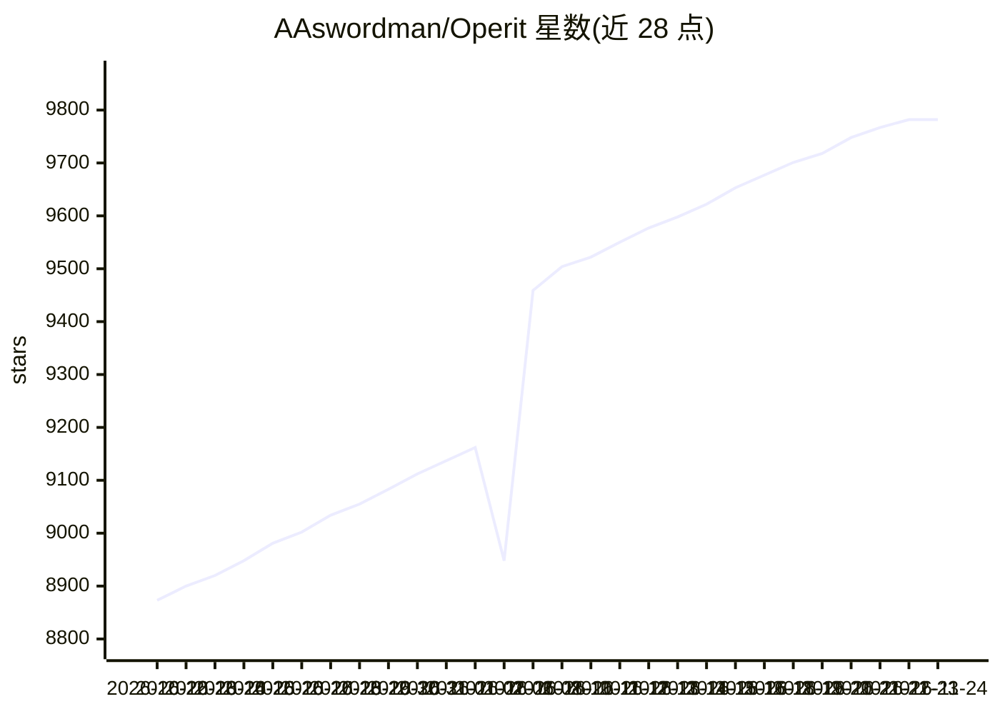

# AAswordman/Operit

⭐ 9,782 · Kotlin · LGPL-3.0 · 推送 2026-11-18 · [GitHub](https://github.com/AAswordman/Operit) · [官网](https://operit.app) · 个人维护 · 中文 README

**Android 平台的 AI Agent 应用，将模型接入设备能力执行任务**

Operit AI 是一个开源 Android AI Agent 平台，通过工具调用、工作流及 ToolPkg/MCP/Skills 扩展，将云端或本地模型连接到 Android 系统能力、终端、浏览器、文件与项目工作区，执行信息检索、文件处理、代码开发、设备自动化等任务。支持内置 MNN 推理与 llama.cpp 运行 GGUF 模型，可连接 Ollama、LM Studio 等本地服务。系统要求 Android 8.0+ 且仅限 ARM64 设备，从 Releases 下载 APK 安装。聊天与配置默认本地存储，应用自身不托管推理。

## 筛选速览

| 维度 | 判定 | 备注 |
|---|---|---|
| AI 角色 | `ai-native` | 本体是模型或模型工具 |
| 许可风险 | `viral` | LGPL-3.0 |
| 部署形态 | `desktop` | 安装包/桌面程序 |
| 模型依赖 | local-ok | 支持本地模型 |
| 硬件要求 | — | 无带数字的原话,不猜 |
| 安装摩擦 | `medium` | 含编译或系统依赖之一 |
| 成熟度 | — | 结构信号不足 |

## 能力要点

- 接入 Android 系统能力、内置浏览器、终端（Ubuntu 24.04 PRoot 用户空间）与项目工作区
- 支持内置 MNN 本地推理与 llama.cpp 运行 GGUF 模型，可连接 Ollama/LM Studio
- 统一扩展市场管理 ToolPkg、Skills、MCP 服务，并提供可视化工作流
- 工具权限分级（自动允许/每次询问/拒绝），默认需授权

## 适用场景

- 在手机上用 AI 完成文件处理与代码开发
- 通过无障碍/ADB/Root 自动化 Android 界面操作
- 用浏览器代理读取和操作网页页面
- 手机端运行本地 GGUF 模型进行推理

## 场景标签

`GUI 自动化` `编码 Agent` `AI 助手` · 领域:效率与自动化

## 证据(README 行号)

> L31: **Operit AI** is an open-source AI Agent platform for Android that supports cloud and local models, connecting them
> L36: - **Your choice of models and services**: Connect cloud models, custom compatible endpoints, and key pools, or use 

## 星数曲线

2026-10-22 8,873 → 2026-11-24 9,782（+909）

---
*卡片 v1 · prompt 1.4 · 生成 2026-11-22 · 置信度 high · 依据 README sha `b8209d2acf79` · [字段定义](../../DATASET.md)*
