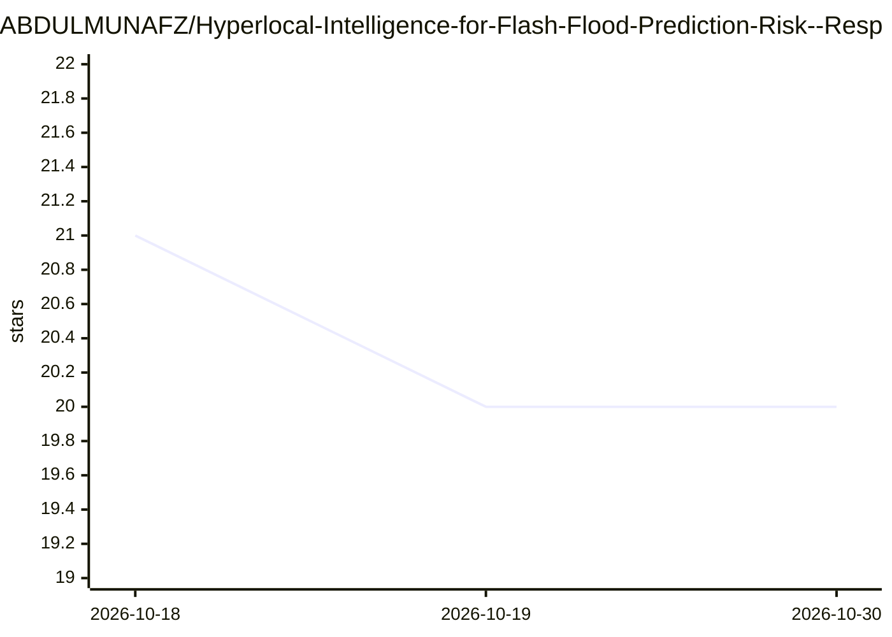

# ABDULMUNAFZ/Hyperlocal-Intelligence-for-Flash-Flood-Prediction-Risk--Response

⭐ 20 · TypeScript · Apache-2.0 · 推送 2026-10-07 · [GitHub](https://github.com/ABDULMUNAFZ/Hyperlocal-Intelligence-for-Flash-Flood-Prediction-Risk--Response) · [官网](https://www.techmavericks.me/) · 组织维护

**山区局地山洪预测与应急响应系统（30米尺度）**

为 Smart India Hackathon 2026（NDRF 问题 26192）构建的山洪预测与风险响应 Web 系统：融合降雨、地形、土壤等多源数据，用 17 特征 ML 集成（Random Forest+XGBoost+logistic）输出 30 米网格风险，配 SCS-CN 径流与二维浅水模拟、SHALSTAB 滑坡模型；面向市民提供 PWA 求救与疏散导航，面向响应者提供地理围栏告警与救援看板。ML 模型明确标注为未验证。通过 Docker Compose 本地部署，技术栈为 React+FastAPI+PostGIS，部署于 AWS。

## 筛选速览

| 维度 | 判定 | 备注 |
|---|---|---|
| AI 角色 | `ai-native` | 本体是模型或模型工具 |
| 许可风险 | `permissive` | Apache-2.0 |
| 部署形态 | `self-host` | docker 或自建部署 |
| 模型依赖 | — | README 未给出锁定关系 |
| 硬件要求 | — | 无带数字的原话,不猜 |
| 安装摩擦 | `low` | 无编译、无系统依赖或容器化 |
| 成熟度 | — | 结构信号不足 |

## 能力要点

- 17 特征 ML 集成输出 30 米网格风险及主要驱动因子
- SCS-CN 径流→二维浅水演算→SHALSTAB 滑坡的物理模拟链
- 市民 PWA：求救定位、最近安全点、步行路线、GPS 验证到达
- PostGIS 地理围栏定向 Web Push 告警与救援调度看板

## 适用场景

- 山区居民在山洪来临前收到所在街区的定向告警并获知最近安全点
- 应急响应者在地图上查看待救援人员位置并指派救援
- 规划者运行洪水/滑坡情景模拟查看逐小时淹没深度与暴露人口

## 场景标签

 · 领域:防灾减灾/地理空间

## 证据(README 行号)

> L78: |🤖|**ML flash-flood risk**|17-feature ensemble (Random Forest + XGBoost + logistic) with top drivers per location —
> L159:   B --> C3["3 · PREDICT 17-feature ML risk % + drivers"]

## 星数曲线

2026-10-18 21 → 2026-10-30 20（-1）

---
*卡片 v1 · prompt 1.4 · 生成 2026-10-28 · 置信度 mid · 依据 README sha `bc87faaa7509` · [字段定义](../../DATASET.md)*
