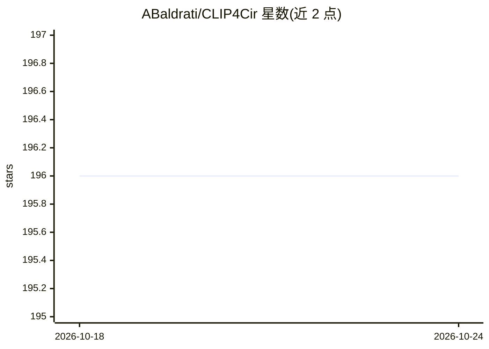

# ABaldrati/CLIP4Cir

⭐ 196 · Python · MIT · 推送 2026-10-12 · [GitHub](https://github.com/ABaldrati/CLIP4Cir) · 组织维护

**组合图像检索研究代码：用 CLIP 特征微调与 Combiner 网络**

ACM TOMM 2023 论文官方代码，处理组合图像检索任务：给定参考图像与修改描述文本，检索整合描述改动的相似图像。方法为两阶段：先对 CLIP 双编码器做任务导向微调（图文特征逐元素求和、对比损失），再训练 Combiner 网络融合多模态特征用于检索。提供 FashionIQ 与 CIRR 两数据集的预处理说明、训练/验证/测试脚本及 GitHub releases 中的预训练检查点。以源码形式提供，推荐 CUDA GPU 与 conda 环境，实验追踪可选 Comet.ml。

## 筛选速览

| 维度 | 判定 | 备注 |
|---|---|---|
| AI 角色 | `ai-native` | 本体是模型或模型工具 |
| 许可风险 | `permissive` | MIT |
| 部署形态 | `library` | 以包/库形式分发 |
| 模型依赖 | — | README 未给出锁定关系 |
| 硬件要求 | — | 无带数字的原话,不猜 |
| 安装摩擦 | `medium` | 含编译或系统依赖之一 |
| 成熟度 | — | 结构信号不足 |

## 能力要点

- 两阶段训练：CLIP 任务导向微调 + Combiner 融合网络
- 提供 FashionIQ 与 CIRR 数据集的预训练检查点
- 训练、验证与 CIRR 测试集提交文件生成脚本
- 代码以清晰可读为目标，未含梯度检查点等优化

## 适用场景

- 在 FashionIQ/CIRR 数据集上复现论文训练与评测
- 下载预训练检查点做组合图像检索实验
- 作为组合图像检索方法的对比基线

## 场景标签

`微调` · 领域:训练与推理

## 证据(README 行号)

> L35: Given a query composed of a reference image and a relative caption, the Composed Image Retrieval goal is to retriev
> L38: tasks, we rely on features from the OpenAI CLIP model to tackle the considered task. We initially perform a task-or

## 星数曲线

2026-10-18 196 → 2026-10-24 196（+0）

---
*卡片 v1 · prompt 1.4 · 生成 2026-10-22 · 置信度 mid · 依据 README sha `b47b684c71f5` · [字段定义](../../DATASET.md)*
