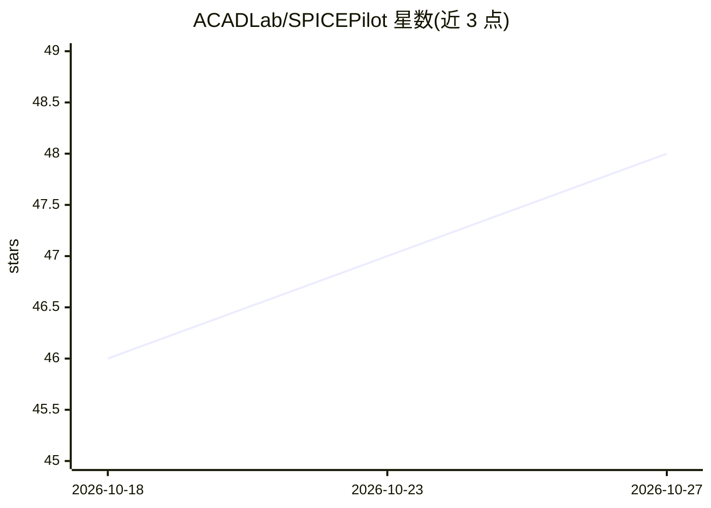

# ACADLab/SPICEPilot

⭐ 48 · Python · MIT · 推送 2026-04-02 · [GitHub](https://github.com/ACADLab/SPICEPilot) · 组织维护

**面向电路设计的 LLM 生成 SPICE 代码框架与基准**

SPICEPilot 是用 LLM 生成 Python 风格 SPICE 代码并驱动电路仿真的框架，基于 PySpice 运行模拟。提供生成代码的错误检测与修正机制、按晶体管数量划分四级难度（Easy/Medium/Hard/Extreme）的基准，按准确率、功能合规与分析能力（AC/DC/瞬态）评估；并利用开源数据集做数据增强。安装需 Python 3.8+，克隆仓库并配置 PySpice；README 未给出具体 LLM 接入方式，使用时需将 prompt_pilot.md 提供给 LLM。附带 arXiv 论文（2410.20553）。

## 筛选速览

| 维度 | 判定 | 备注 |
|---|---|---|
| AI 角色 | `ai-ecosystem` | LLM/agent 周边工具 |
| 许可风险 | `permissive` | MIT |
| 部署形态 | `None` |  |
| 模型依赖 | — | README 未给出锁定关系 |
| 硬件要求 | — | 无带数字的原话,不猜 |
| 安装摩擦 | `low` | 无编译、无系统依赖或容器化 |
| 成熟度 | — | 结构信号不足 |

## 能力要点

- LLM 生成 Python 风格 SPICE 代码，基于 PySpice 仿真
- 四级难度基准（按晶体管数量），评估准确率/功能合规/分析能力
- 生成代码的错误识别与修正机制
- 利用开源数据集做数据增强

## 适用场景

- 我需要让 LLM 自动生成模拟电路的 SPICE 仿真代码
- 我需要按难度分级基准评估 LLM 的电路生成能力
- 我做模拟电路设计的 LLM 研究需要数据增强与基准

## 场景标签

`代码生成` `模型评测` · 领域:编码与开发

## 证据(README 行号)

> L7: **SPICEPilot** is an AI-driven framework designed to enhance the automation of SPICE code generation and circuit sim
> L17: - **Automated SPICE Code Generation:** Uses LLMs to generate Python-based SPICE codes for a range of circuit config
> L41: SPICEPilot includes a benchmarking framework to assess LLM performance in circuit generation. Circuits are categori

## 星数曲线

2026-10-18 46 → 2026-10-27 48（+2）

---
*卡片 v1 · prompt 1.4 · 生成 2026-10-25 · 置信度 high · 依据 README sha `7a08ad494f81` · [字段定义](../../DATASET.md)*
