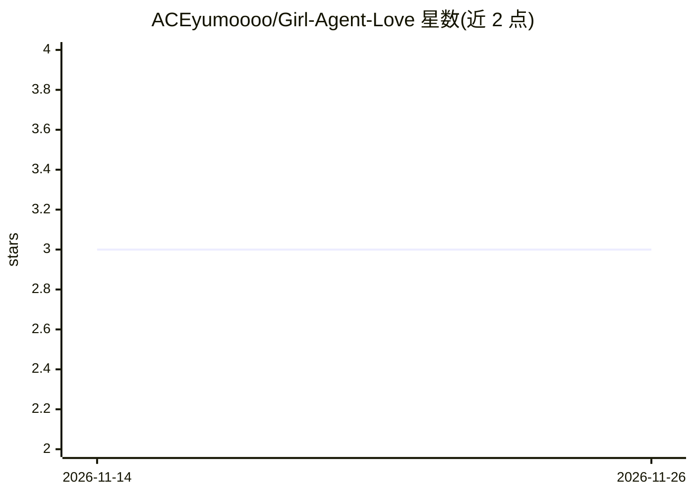

# ACEyumoooo/Girl-Agent-Love

⭐ 3 · Ren'Py · Apache-2.0 · 推送 2026-11-17 · [GitHub](https://github.com/ACEyumoooo/Girl-Agent-Love) · 个人维护 · 中文 README

**基于 Ren'Py 的 AI 实时生成 galgame 框架**

以 Ren'Py 引擎为载体的框架：AI 按人物卡与世界世界观文件实时生成剧情文本，配合立绘注册、背景图按时间/地点匹配、TTS 语音（阿里云百炼/mimo/OpenAI）与 BGM 播放。提供子智能体模式（每张非玩家卡一个子调用，父模型补旁白与选项）、自愈模式（后台模型检测并修改错误）、存档与日记记录。安装需 Ren'Py 8.5.3，从 GitHub Releases 下载 ZIP 解压后由 Ren'Py Launcher 启动，或交由带 skill 的 agent 引导使用。

## 筛选速览

| 维度 | 判定 | 备注 |
|---|---|---|
| AI 角色 | `ai-native` | 本体是模型或模型工具 |
| 许可风险 | `permissive` | Apache-2.0 |
| 部署形态 | `None` |  |
| 模型依赖 | — | README 未给出锁定关系 |
| 硬件要求 | — | 无带数字的原话,不猜 |
| 安装摩擦 | `low` | 无编译、无系统依赖或容器化 |
| 成熟度 | `idea` | |

## 能力要点

- AI 实时生成剧情，人物卡与世界观以 markdown 文件配置
- 子智能体模式：每个角色卡独立子调用，父模型统筹旁白与选项
- 自愈模式后台检测错误并修改，可经 harness 或内置模型运行
- 支持 TTS 语音（阿里云百炼/mimo/OpenAI）与声音克隆

## 适用场景

- 制作属于自己的 AI 实时生成 galgame
- 制作女性向作品（默认主角为男，可通过对话修改）
- 使用人物卡配置自己喜欢的角色并生成立绘与语音

## 场景标签

`语音合成` · 领域:内容生成

## 证据(README 行号)

> L5: Girl Agent Love 是一个可以通过 Ren'Py 引擎来使用 AI 实时输出的框架。它可以用来自己做一个属于自己的 galgame。
> L22: `ai.rpy` 管模型调用、预取、剧情树、重注入、子智能体、日记、harness 和生图。`script.rpy` 管图片注册、渲染循环、存读档界面和动态舞台。

## 星数曲线

2026-11-14 3 → 2026-11-26 3（+0）

---
*卡片 v1 · prompt 1.4 · 生成 2026-11-22 · 置信度 high · 依据 README sha `8658e06fb444` · [字段定义](../../DATASET.md)*
