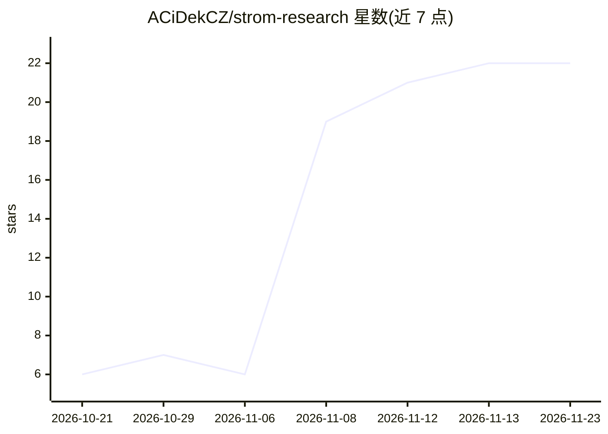

# ACiDekCZ/strom-research

⭐ 22 · TypeScript · AGPL-3.0 · 推送 2026-11-22 · [GitHub](https://github.com/ACiDekCZ/strom-research) · [官网](https://stromapp.info) · 个人维护 · 中文 README

**把 AI agent 变成家谱研究员：查教区档案、留证据、生成 GEDCOM**

strom 是一个 CLI 工具，把用户已有的编程 agent（Claude Code、OpenAI Codex、Google Antigravity、OpenCode、Grok）转为家谱研究助手：agent 搜索教区登记册与档案，每条事实须引用记录（卷页、条目），无证据的事实只作线索；所有变更以 git commit 记录。结果输出 GEDCOM 文件供 Strom 应用或其他程序使用，并可撰写祖先故事。本地运行，自带官方 Node，无需管理员权限，零运行时依赖（仅 Node 内置与 git）。需要用户自备 agent 订阅账号。

## 筛选速览

| 维度 | 判定 | 备注 |
|---|---|---|
| AI 角色 | `ai-native` | 本体是模型或模型工具 |
| 许可风险 | `viral` | AGPL-3.0 |
| 部署形态 | `library` | 以包/库形式分发 |
| 模型依赖 | — | README 未给出锁定关系 |
| 硬件要求 | — | 无带数字的原话,不猜 |
| 安装摩擦 | `low` | 无编译、无系统依赖或容器化 |
| 成熟度 | — | 结构信号不足 |

## 能力要点

- 事实须引用档案记录，无证据条目仅作线索
- 每个变更为 git commit，agent 不直接编辑数据
- 为未知在线档案自动编写 connector 下载器，含请求限速
- 支持多 agent 并行同一棵树、任务队列自动循环运行

## 适用场景

- 用对话方式研究家族史并产出可导入的 GEDCOM 家谱
- 整理教区登记册证据并溯源每条家族事实
- 把研究成果打包成 ZIP 分享给亲属

## 场景标签

 · 领域:家谱/档案研究工具

## 证据(README 行号)

> L3: Research your family's history with an AI agent. `strom` turns an AI agent —
> L75: - Every fact cites its record (folio, entry, the words of the register);
> L94: - GEDCOM for the Strom app (witnesses, stories, sources per page) and a strict

## 星数曲线

2026-10-21 6 → 2026-11-23 22（+16）

---
*卡片 v1 · prompt 1.4 · 生成 2026-11-18 · 置信度 high · 依据 README sha `aac7a440bade` · [字段定义](../../DATASET.md)*
