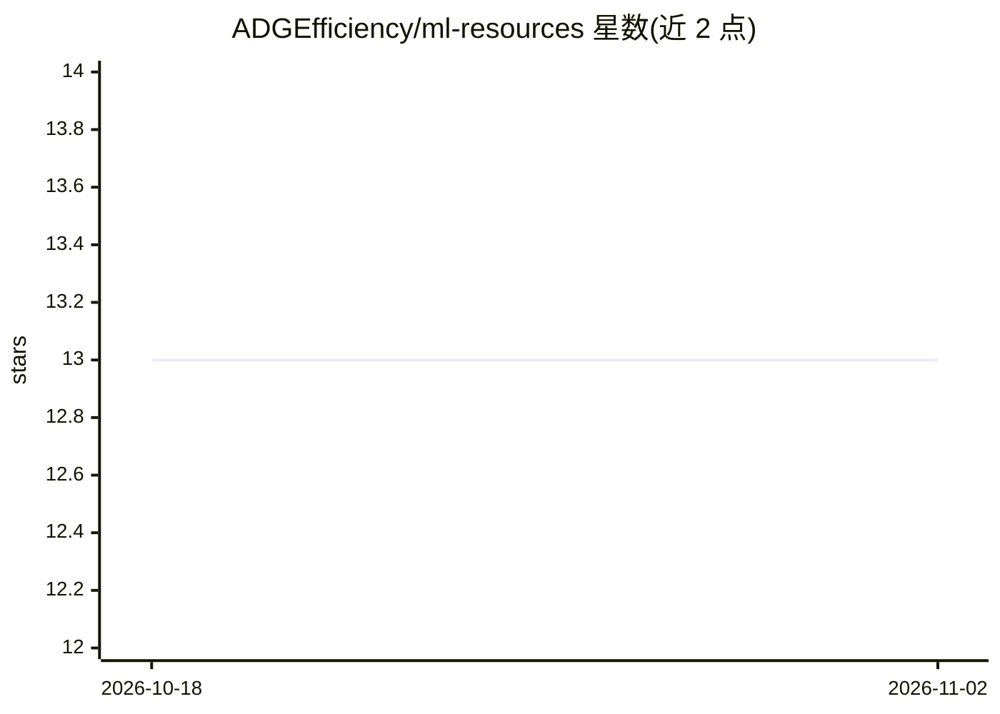

# ADGEfficiency/ml-resources

⭐ 13 · 推送 2026-10-03 · [GitHub](https://github.com/ADGEfficiency/ml-resources) · 个人维护

**个人维护的机器学习学习资源清单（书籍/论文/社区）**

作者以清单形式整理的机器学习入门与进阶资源：推荐 Deep Learning、Elements of Statistical Learning、Pattern Recognition and Machine Learning 等教材并给出建议阅读章节，收录论文阅读路线图（floodsung/Deep-Learning-Papers-Reading-Roadmap）、Rich Sutton 的 The Bitter Lesson 摘录，以及 Papers With Code、Distill、UC Irvine 数据集仓库等生态资源。面向机器学习初学者与自学者，无安装运行概念，仅作为阅读指引使用。README 同页还链接了作者的 rl-resources 与 programming resources 清单。

## 筛选速览

| 维度 | 判定 | 备注 |
|---|---|---|
| AI 角色 | `ai-knowledge` | 知识聚合/清单类 |
| 许可风险 | `none` | — |
| 部署形态 | `None` |  |
| 模型依赖 | — | README 未给出锁定关系 |
| 硬件要求 | — | 无带数字的原话,不猜 |
| 安装摩擦 | `low` | 无编译、无系统依赖或容器化 |
| 成熟度 | — | 结构信号不足 |

## 能力要点

- 推荐多本经典 ML 教材并标注建议阅读章节
- 收录论文阅读路线图与 The Bitter Lesson 摘录
- 汇总 Papers With Code、Distill、UC Irvine 数据集等生态资源

## 适用场景

- 机器学习入门时挑选教材并按建议章节阅读
- 查找论文阅读路线与 ML 社区/数据集资源

## 场景标签

`精选清单` · 领域:学习与行业

## 证据(README 行号)

> L1: # ml-resources
> L3: My personal machine learning resources. If you like this, check out rl-resources and programming resources.

## 星数曲线

2026-10-18 13 → 2026-11-02 13（+0）

---
*卡片 v1 · prompt 1.4 · 生成 2026-10-31 · 置信度 high · 依据 README sha `3d8485b33480` · [字段定义](../../DATASET.md)*
