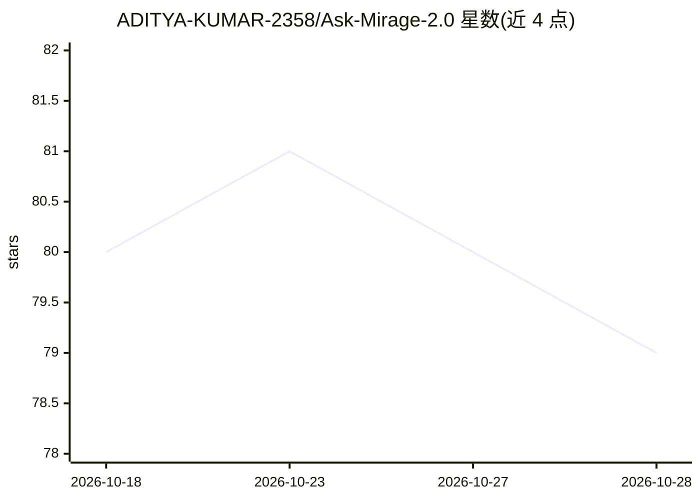

# ADITYA-KUMAR-2358/Ask-Mirage-2.0

⭐ 81 · Python · 推送 2026-04-17 · [GitHub](https://github.com/ADITYA-KUMAR-2358/Ask-Mirage-2.0) · 个人维护

**离线 PDF 问答聊天机器人：本地文档自然语言检索问答**

基于 Flask 的 Web 应用：用户上传 PDF，系统用 PyPDF 提取文本、SentenceTransformer 生成嵌入、FAISS 做向量相似检索，再由 LLaMA 模型生成回答，全程本地运行无需联网。面向需要处理大文档的学生与专业人士，定位为离线、隐私优先的文档问答工具。README 未给出安装或运行命令，部署需联系作者获取指引。

## 筛选速览

| 维度 | 判定 | 备注 |
|---|---|---|
| AI 角色 | `ai-native` | 本体是模型或模型工具 |
| 许可风险 | `none` | — |
| 部署形态 | `None` |  |
| 模型依赖 | — | README 未给出锁定关系 |
| 硬件要求 | — | 无带数字的原话,不猜 |
| 安装摩擦 | `low` | 无编译、无系统依赖或容器化 |
| 成熟度 | — | 结构信号不足 |

## 能力要点

- PDF 上传与文本提取（PyPDF）
- FAISS 向量相似检索 + SentenceTransformer 嵌入
- LLaMA 本地生成回答，无需联网
- Flask 后端 + HTML/CSS/JS 前端

## 适用场景

- 离线环境下对 PDF 文档做问答
- 阅读长文档时用自然语言提问检索内容
- 隐私敏感文档的本地化问答处理

## 场景标签

`文档问答` · 领域:知识与检索

## 证据(README 行号)

> L3: **ASK MIRAGE** is an offline AI-powered chatbot that allows users to upload PDF documents and ask natural language q
> L20: - 🧠 **Context-Aware Responses** – Uses LLaMA for intelligent replies

## 星数曲线

2026-10-18 80 → 2026-10-28 79（-1）

---
*卡片 v1 · prompt 1.4 · 生成 2026-10-24 · 置信度 high · 依据 README sha `83153bc1d54b` · [字段定义](../../DATASET.md)*
