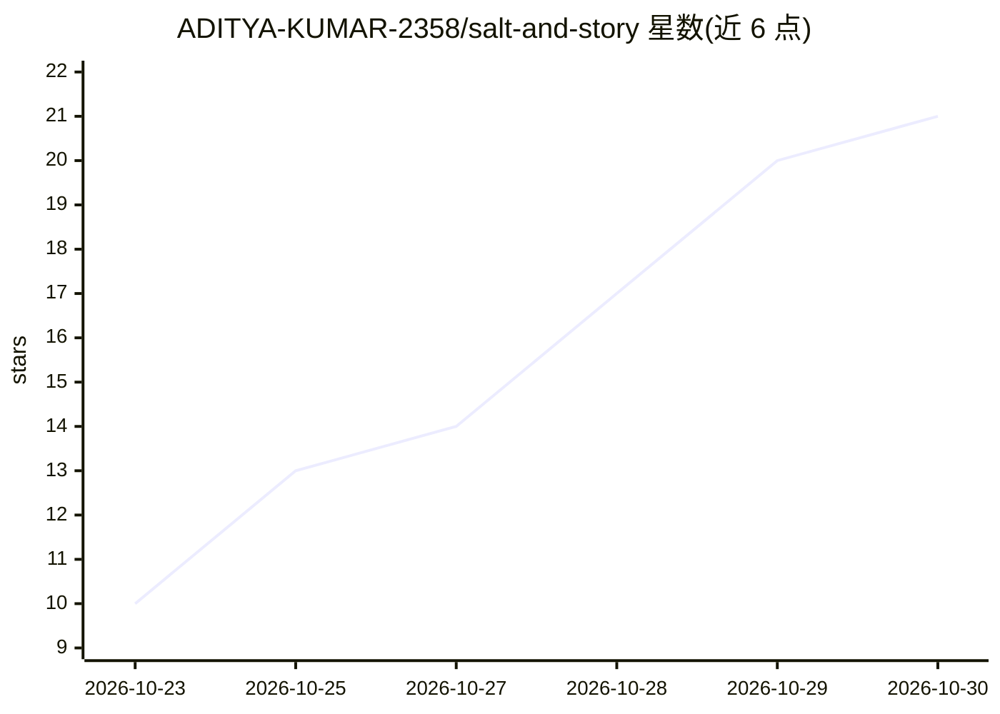

# ADITYA-KUMAR-2358/salt-and-story

⭐ 21 · JavaScript · NOASSERTION · 推送 2026-10-26 · [GitHub](https://github.com/ADITYA-KUMAR-2358/salt-and-story) · [官网](saltandstory.site) · 个人维护

**把亲属做菜的语音备忘转成可打印食谱并生成纪念食谱书 PDF**

面向家庭用户的全栈 Web 应用（React SPA + FastAPI）：录音、上传或粘贴转录文本后，ElevenLabs 负责转写，开源权重模型 Gemma 4 通过任意 OpenAI 兼容端点将口语整理成结构化食谱，保留讲述者原话（含原文引用行），并可生成 A5 版式的食谱书 PDF（照片+故事+菜谱对页）。带 Google 登录、每日配额与限流、阅读/做菜模式、朗读等家庭场景功能。Docker 一键部署，数据自持；限英文，免费托管重启会丢数据。

## 筛选速览

| 维度 | 判定 | 备注 |
|---|---|---|
| AI 角色 | `ai-native` | 本体是模型或模型工具 |
| 许可风险 | `none` | NOASSERTION |
| 部署形态 | `self-host` | docker 或自建部署 |
| 模型依赖 | local-ok | 支持本地模型 |
| 硬件要求 | — | 无带数字的原话,不猜 |
| 安装摩擦 | `low` | 无编译、无系统依赖或容器化 |
| 成熟度 | — | 结构信号不足 |

## 能力要点

- ElevenLabs 转写 + Gemma 4（OpenAI 兼容端点，可选本地 Ollama）生成结构化食谱
- 生成 A5 食谱书 PDF：每道菜一页故事照片、一页食材步骤
- 保留原话引用并在代码中对照转录核验，配额与限流防滥用
- Docker Compose 一键部署，数据存本地卷，密钥仅走环境变量

## 适用场景

- 把长辈口述的家常菜整理成可打印的纪念食谱书
- 家庭内部私有保存食谱并附带原话与照片
- 无密钥时粘贴文字或手写录入，或本地 Ollama 免费运行

## 场景标签

`语音识别` `AI 写作` · 领域:内容生成

## 证据(README 行号)

> L5: Salt & Story turns voice memos of a relative cooking into clean, printable recipes, while keeping the speaker's own 
> L16: - **Write it up**: ElevenLabs transcribes; Gemma 4 structures the recipe. Vague amounts get a measurement *and* kee
> L27: - **The family's voice stays in the family's hands.** Recipes and audio live on your own server. Audio goes to Elev

## 星数曲线

2026-10-23 10 → 2026-10-30 21（+11）

---
*卡片 v1 · prompt 1.4 · 生成 2026-10-28 · 置信度 high · 依据 README sha `a3900f78712c` · [字段定义](../../DATASET.md)*
