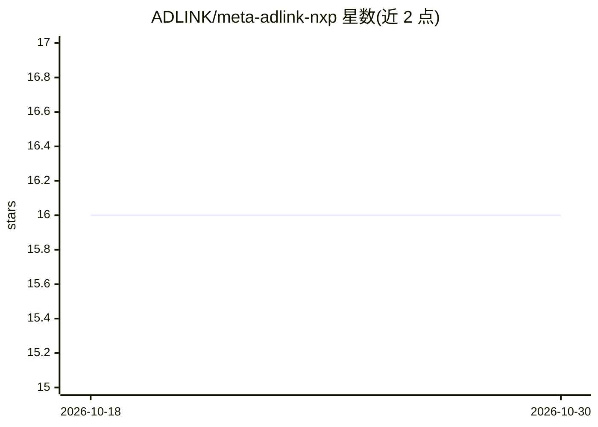

# ADLINK/meta-adlink-nxp

⭐ 16 · 推送 2026-10-29 · [GitHub](https://github.com/ADLINK/meta-adlink-nxp) · 组织维护

**ADLINK NXP i.MX 系列模块的统一 Yocto BSP 层**

ADLINK 维护的单一 Yocto 层，为旗下全部 NXP i.MX 模组（LEC-IMX8MM、LEC-IMX8MP、LEC-IMX95、OSM-IMX93、OSM-IMX95、SP2-IMX8MP）提供 BSP recipes，用户可据此构建定制化 BSP 镜像。仓库含 8 个分支（Wrynose 至 Warrior，对应不同 Yocto 版本），提供基于 NXP GitHub 内核（5.15.x）的补丁，内核 5.15 起 Wi-Fi/BT 走 SDIO/UART。构建与烧录步骤见 wiki 页面。

## 筛选速览

| 维度 | 判定 | 备注 |
|---|---|---|
| AI 角色 | `ai-ecosystem` | LLM/agent 周边工具 |
| 许可风险 | `none` | — |
| 部署形态 | `None` |  |
| 模型依赖 | — | README 未给出锁定关系 |
| 硬件要求 | — | 无带数字的原话,不猜 |
| 安装摩擦 | `low` | 无编译、无系统依赖或容器化 |
| 成熟度 | — | 结构信号不足 |

## 能力要点

- 单一 Yocto 层覆盖 7 款 NXP i.MX 模组
- 提供 8 个 Yocto 版本分支（Wrynose/Scarthgap/Mickledore 等）
- 基于 NXP GitHub 内核 5.15.x 的适配补丁

## 适用场景

- 为 ADLINK i.MX 模组构建定制化 Yocto BSP 镜像
- 获取 ADLINK 开发套件的内核补丁
- 查阅各模组的硬件文档链接

## 场景标签

 · 领域:嵌入式 Linux/边缘计算

## 证据(README 行号)

> L1: This repo is dedicated to the NXP IMX-based modules. Here you can find the Yocto BSP recipes.
> L5: # 1. Supported Hardware

## 星数曲线

2026-10-18 16 → 2026-10-30 16（+0）

---
*卡片 v1 · prompt 1.4 · 生成 2026-10-30 · 置信度 mid · 依据 README sha `05e5768b539e` · [字段定义](../../DATASET.md)*
