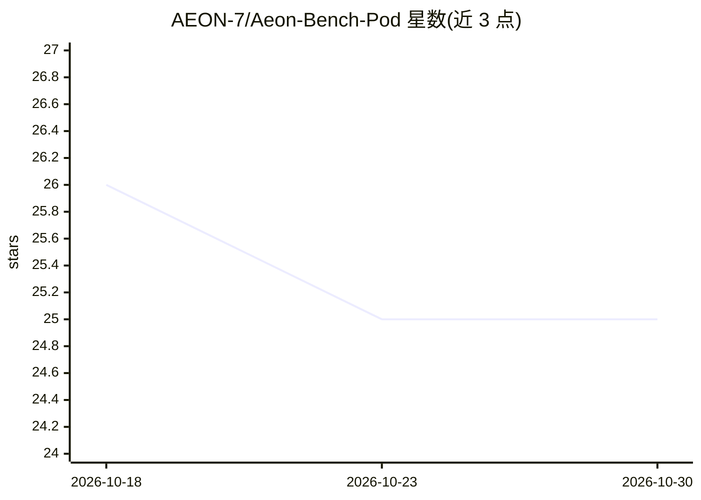

# AEON-7/Aeon-Bench-Pod

⭐ 25 · Python · MIT · 推送 2026-10-06 · [GitHub](https://github.com/AEON-7/Aeon-Bench-Pod) · 组织维护

**本地 LLM 基准测试套件：自硬件评测并签名提交排行榜**

面向本地硬件的 LLM 评测工具：以 Docker 容器形式运行，从 Hugging Face 拉取模型并用 sha256+manifest 校验权重，经记录的 recipe 启动服务，随后运行覆盖文本（5 类×6 难度、174 例）、三个第三方编码 agent harness、视觉/音频/视频、生成竞技场与性能网格（tok/s、TTFT 并发梯度）的完整套件，结果以 ed25519 设备密钥签名后可提交至 aeon-bench.com 公共排行榜。支持 Apple silicon（推荐 MLX 裸机路径）与 CPU-only 主机，附带 MCP server 供 AI agent 调用。完整跑完大模型可能需数小时。

## 筛选速览

| 维度 | 判定 | 备注 |
|---|---|---|
| AI 角色 | `ai-ecosystem` | LLM/agent 周边工具 |
| 许可风险 | `permissive` | MIT |
| 部署形态 | `self-host` | docker 或自建部署 |
| 模型依赖 | local-ok | 支持本地模型 |
| 硬件要求 | — | 无带数字的原话,不猜 |
| 安装摩擦 | `low` | 无编译、无系统依赖或容器化 |
| 成熟度 | — | 结构信号不足 |

## 能力要点

- 拉取→权重校验→服务→评测→ed25519 签名→提交的可复现流水线
- 文本/agent×3 harness/视觉/音频/视频/竞技场/性能多维度套件
- 按硬件给出 champion recipe，读取模型 chat template 自动匹配 tool-call parser
- 内置 MCP server，AI agent 可通过 AGENTS.md/SKILL.md 全程部署执行

## 适用场景

- 在自己硬件上验证模型厂商宣称的跑分
- 把可信的评测结果提交公共排行榜与他人对比
- 为特定 GPU/主机挑选最快的模型与推理配置

## 场景标签

`模型评测` · 领域:评测与运维

## 证据(README 行号)

> L121: Under the hood, a "validated" run is a controlled pipeline:
> L124: pull (Hugging Face) → verify weights (LFS sha256 + manifest) → serve (recorded recipe)

## 星数曲线

2026-10-18 26 → 2026-10-30 25（-1）

---
*卡片 v1 · prompt 1.4 · 生成 2026-10-27 · 置信度 mid · 依据 README sha `6ec890f1b59d` · [字段定义](../../DATASET.md)*
