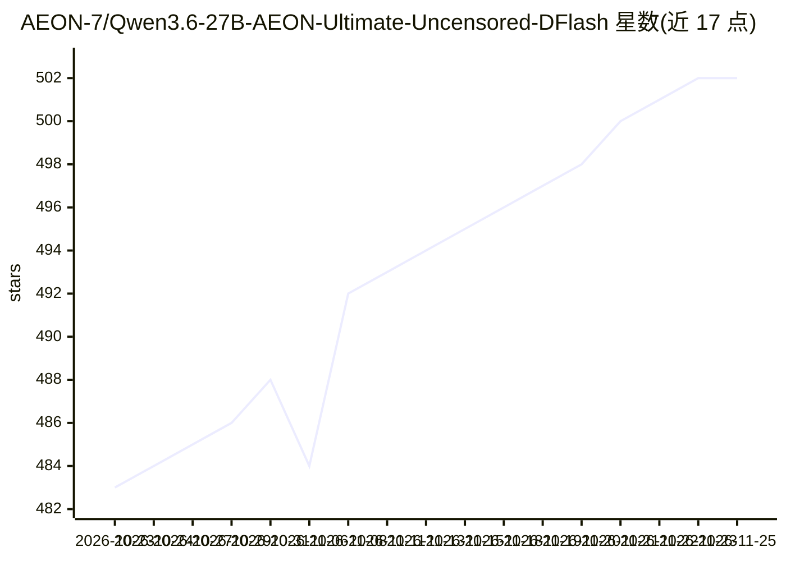

# AEON-7/Qwen3.6-27B-AEON-Ultimate-Uncensored-DFlash

⭐ 502 · Python · Apache-2.0 · 推送 2026-11-13 · [GitHub](https://github.com/AEON-7/Qwen3.6-27B-AEON-Ultimate-Uncensored-DFlash) · [官网](https://huggingface.co/AEON-7/Qwen3.6-27B-AEON-Ultimate-Uncensored-BF16) · 个人维护

**Qwen3.6-27B 去审查量化模型及 DGX Spark 专用 vLLM 容器**

对 Qwen/Qwen3.6-27B 做 abliteration 处理（README 自报 100 条拒绝全通过、KL 0.000492），提供 BF16/NVFP4/MTP/MTP-XS 六种 HuggingFace 权重变体，并附带 ghcr.io 上的统一 vLLM 容器，内置 z-lab DFlash 投机解码（n=10/12）、sm_121a NVFP4 内核、Qwen3 推理解析器与工具调用解析器。容器仅支持 DGX Spark/GB10（ARM64），x86 或非 Blackwell GPU 上不运行；其他硬件需自行用 vLLM 加载 HF 权重。附 docker-compose、基准结果 JSON 与 DDTree 研究文档。

## 筛选速览

| 维度 | 判定 | 备注 |
|---|---|---|
| AI 角色 | `ai-native` | 本体是模型或模型工具 |
| 许可风险 | `permissive` | Apache-2.0 |
| 部署形态 | `self-host` | docker 或自建部署 |
| 模型依赖 | local-ok | 支持本地模型 |
| 硬件要求 | — | 无带数字的原话,不猜 |
| 安装摩擦 | `low` | 无编译、无系统依赖或容器化 |
| 成熟度 | — | 结构信号不足 |

## 能力要点

- 6 种 HF 权重变体（BF16/NVFP4/MTP/MTP-XS）
- 统一 vLLM 容器内置 DFlash 投机解码与 NVFP4 内核
- OpenAI 兼容端点（localhost:8000/v1）与 docker-compose/gateway/benchmark profiles
- 基准 JSON 文件与 DDTree 集成计划文档随仓库提供

## 适用场景

- 在 DGX Spark 上本地部署去审查的 Qwen3.6-27B 推理服务
- 在其他 Blackwell GPU 上用自建 vLLM 加载 NVFP4 权重
- 复现或对比 DFlash 投机解码的吞吐数据

## 场景标签

`推理引擎` `模型量化` · 领域:训练与推理

## 证据(README 行号)

> L21: A **fully uncensored, capability-enhanced** abliteration of Qwen/Qwen3.6-27B, produced over **72 hours of continuou
> L25: > ⚠️ **This container is DGX Spark / GB10 only — it is not portable.** `aeon-vllm-ultimate` is built for the Spark'
> L31: docker pull ghcr.io/aeon-7/aeon-vllm-ultimate:latest

## 星数曲线

2026-10-23 483 → 2026-11-25 502（+19）

---
*卡片 v1 · prompt 1.4 · 生成 2026-11-25 · 置信度 high · 依据 README sha `5bfe9c069ed2` · [字段定义](../../DATASET.md)*
