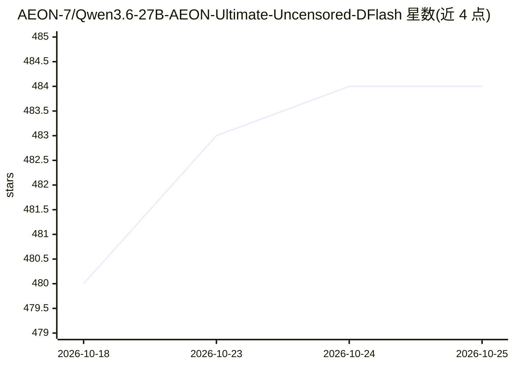

# AEON-7/Qwen3.6-27B-AEON-Ultimate-Uncensored-DFlash

⭐ 484 · Python · Apache-2.0 · 推送 2026-10-06 · [GitHub](https://github.com/AEON-7/Qwen3.6-27B-AEON-Ultimate-Uncensored-DFlash) · [官网](https://huggingface.co/AEON-7/Qwen3.6-27B-AEON-Ultimate-Uncensored-BF16) · 个人维护

**面向开发者的 Qwen3.6-27B 去审查模型权重与 DGX Spark 专用推理容器**

对 Qwen/Qwen3.6-27B 做 abliteration 处理的去审查模型项目，提供 6 个 HuggingFace 变体（BF16/NVFP4/MTP/MTP-XS）。核心交付物是统一的 ghcr.io/aeon-7/aeon-vllm-ultimate 容器（vLLM 0.23.0 + sm_121a NVFP4 内核 + DFlash 投机解码，n=10/12），专门面向 DGX Spark/GB10（ARM64 + Blackwell），在 x86 或非 Blackwell GPU 上无法运行。提供 OpenAI 兼容端点、docker-compose、性能基准数据与 DDTree 研究轨道文档。README 顶部声明新部署建议改用 Qwen3.8，本卡片保留给既有部署与历史。

## 筛选速览

| 维度 | 判定 | 备注 |
|---|---|---|
| AI 角色 | `ai-native` | 本体是模型或模型工具 |
| 许可风险 | `permissive` | Apache-2.0 |
| 部署形态 | `self-host` | docker 或自建部署 |
| 模型依赖 | local-ok | 支持本地模型 |
| 硬件要求 | — | 无带数字的原话,不猜 |
| 安装摩擦 | `low` | 无编译、无系统依赖或容器化 |
| 成熟度 | — | 结构信号不足 |

## 能力要点

- 提供 6 个 HF 变体（BF16/NVFP4/MTP/MTP-XS）可移植权重
- DFlash 投机解码容器（vLLM 0.23.0，sm_121a NVFP4 内核），给出分类别吞吐基准
- 仅支持 DGX Spark/GB10（ARM64 + Blackwell sm_121a），其他硬件需自行用 vLLM 加载 HF 权重
- 内置 vLLM PR #40898/#41703 补丁修复 SWA 起草与 prefix caching 问题

## 适用场景

- 在 DGX Spark 上本地部署长上下文推理服务（OpenAI 兼容端点）
- 用 HF 可移植权重在其他 GPU 上自行构建 vLLM 推理
- 查阅 DFlash 投机解码在 GB10 上的性能基准与调参记录

## 场景标签

`推理引擎` `模型量化` · 领域:训练与推理

## 证据(README 行号)

> L21: A **fully uncensored, capability-enhanced** abliteration of Qwen/Qwen3.6-27B, produced over **72 hours of continuou
> L25: > ⚠️ **This container is DGX Spark / GB10 only — it is not portable.** `aeon-vllm-ultimate` is built for the Spark'
> L30: # 1) Pull the unified AEON vLLM container (vLLM 0.23.0, sm_121a, DFlash)

## 星数曲线

2026-10-18 480 → 2026-10-25 484（+4）

---
*卡片 v1 · prompt 1.4 · 生成 2026-10-22 · 置信度 high · 依据 README sha `b6b8c7abf613` · [字段定义](../../DATASET.md)*
