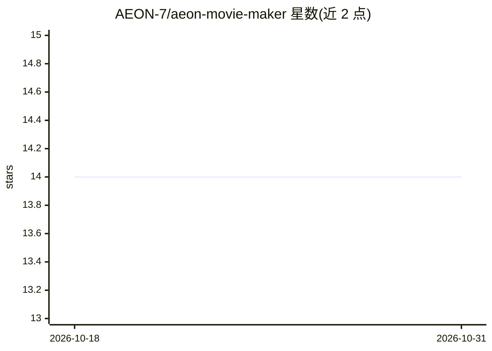

# AEON-7/aeon-movie-maker

⭐ 14 · Python · MIT · 推送 2026-10-06 · [GitHub](https://github.com/AEON-7/aeon-movie-maker) · 个人维护

**基于 LTX 2.3 22B 的电影级视频生成 CLI 工具**

Python CLI 工具，通过 HTTP 向 ComfyUI 发送 LTX 2.3 22B（fp8）工作流生成视频。提供三个子命令：clip 渲染单镜头、screenplay 按 JSON 剧本渲染多镜头影片（末帧前传保持角色/场景连续性）、stitch 将对白+音乐+音效做侧链闪避混音合成成片。支持 T2V/I2V、Prompt Relay 联合音视频（模型生成对白+口型同步）、按风格标签路由 LoRA。前提：本地或远程 ComfyUI、Python 3.10+、ffmpeg，约 80GB 磁盘存放模型。

## 筛选速览

| 维度 | 判定 | 备注 |
|---|---|---|
| AI 角色 | `ai-native` | 本体是模型或模型工具 |
| 许可风险 | `permissive` | MIT |
| 部署形态 | `None` |  |
| 模型依赖 | — | README 未给出锁定关系 |
| 硬件要求 | — | 无带数字的原话,不猜 |
| 安装摩擦 | `medium` | 含编译或系统依赖之一 |
| 成熟度 | — | 结构信号不足 |

## 能力要点

- 三个子命令：clip / screenplay / stitch，覆盖单镜头到成片
- 末帧前传 + 角色种子偏移，维持跨镜头角色一致性
- Prompt Relay 联合音视频：同一前向生成视频与带口型同步的对白
- stitch 侧链闪避混音并对白下压约 12dB 后 loudnorm 归一

## 适用场景

- 从结构化 JSON 剧本生成带角色连续性的多镜头短片
- 单镜头文生视频/图生视频渲染
- 将渲染片段与自配音乐、对白、音效混流为成片

## 场景标签

`视频生成` · 领域:内容生成

## 证据(README 行号)

> L4: > Fast cinematic video generation built around LTX 2.3 22B (distilled fp8). Three subcommands: render a single clip,
> L32: |**ComfyUI**|The model-serving program that actually generates the pixels. This tool sends it workflow instructions
> L65: python scripts/movie_maker_fast.py clip \

## 星数曲线

2026-10-18 14 → 2026-10-31 14（+0）

---
*卡片 v1 · prompt 1.4 · 生成 2026-10-31 · 置信度 high · 依据 README sha `e48fdc77503d` · [字段定义](../../DATASET.md)*
