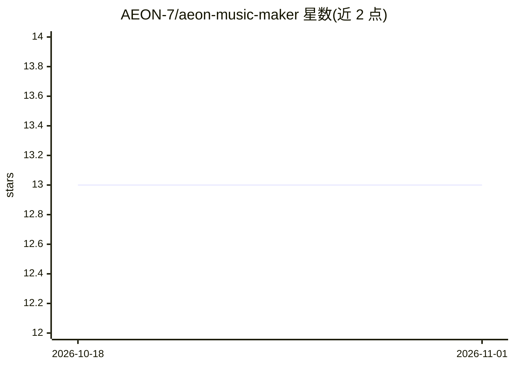

# AEON-7/aeon-music-maker

⭐ 13 · Python · MIT · 推送 2026-10-06 · [GitHub](https://github.com/AEON-7/aeon-music-maker) · 个人维护

**面向音乐创作者的 ACE Step 文生音乐 CLI，带母带处理**

独立音乐生成工具：封装 ACE Step 1.5 XL（5 种变体，从全质量 APG 链到 8 步快速蒸馏版），生成后经过一遍式母带链（高通滤波→EQ→磁带饱和→LUFS 增益匹配→真峰上限），默认输出 48 kHz 无损 FLAC。作为 ComfyUI 服务器的客户端运行，支持本地或远程 GPU 机（HTTP/SSH 隧道）两种模式，通过环境变量配置。支持种子复现（同提示词+同种子字节级一致）与歌词演唱。限制：需自备运行中的 ComfyUI 实例与约 30 GB 模型磁盘空间，ffmpeg/ffprobe 必需。

## 筛选速览

| 维度 | 判定 | 备注 |
|---|---|---|
| AI 角色 | `ai-native` | 本体是模型或模型工具 |
| 许可风险 | `permissive` | MIT |
| 部署形态 | `library` | 以包/库形式分发 |
| 模型依赖 | — | README 未给出锁定关系 |
| 硬件要求 | — | 无带数字的原话,不猜 |
| 安装摩擦 | `medium` | 含编译或系统依赖之一 |
| 成熟度 | — | 结构信号不足 |

## 能力要点

- 5 个 ACE Step 变体，一条 CLI 参数切换（50 步全质量到 8 步快速版）
- 一遍式母带链默认不含压缩器，声明保留动态范围（管弦乐素材 LRA 偏差约 1 LU）
- 种子级可复现：同提示词+同种子输出字节一致
- 支持歌词演唱与 6 种母带预设（按提示词关键词自动选择）

## 适用场景

- 用文本提示词生成带母带处理的无损音乐成品
- 在远程 GPU 机器上运行 ComfyUI、本地笔记本指挥生成
- 为播客、广播剧等作品生成可复现的配乐素材

## 场景标签

 · 领域:音频生成/音乐制作

## 证据(README 行号)

> L4: > Standalone music generator with studio-grade dynamics-preserving mastering. Wraps ACE Step 1.5 XL (full-quality AP
> L172: - **ACE Step 1.5** by StepFun — the music generation model

## 星数曲线

2026-10-18 13 → 2026-11-01 13（+0）

---
*卡片 v1 · prompt 1.4 · 生成 2026-10-31 · 置信度 mid · 依据 README sha `51bb989ad528` · [字段定义](../../DATASET.md)*
