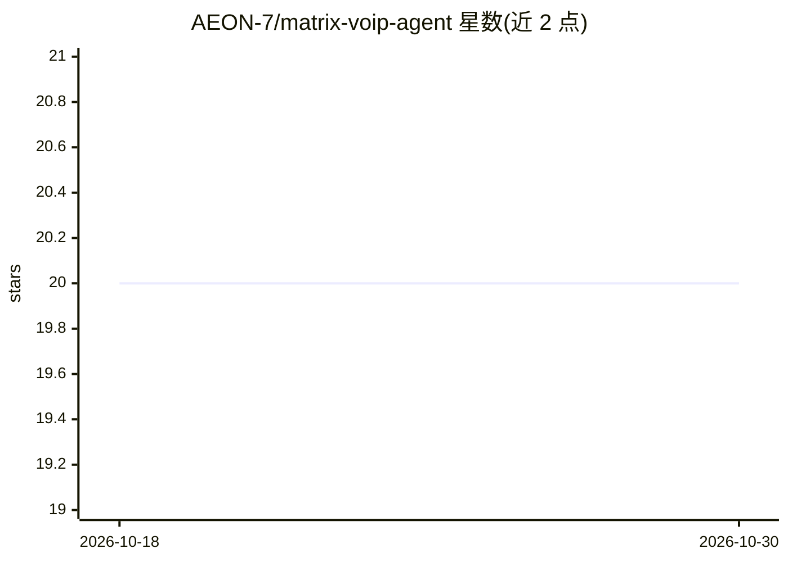

# AEON-7/matrix-voip-agent

⭐ 20 · TypeScript · MIT · 推送 2026-10-06 · [GitHub](https://github.com/AEON-7/matrix-voip-agent) · 组织维护

**Matrix 语音/视频通话 AI 代理：自动接听并桥接 STT/LLM/TTS 对话**

运行于 Linux 的无头 Matrix WebRTC 语音与视频通话代理：自动接听或发起 Matrix VoIP 呼叫，经 PipeWire 虚拟音频设备将通话音频桥接到 STT、LLM 与 TTS 管线，实现实时语音对话。STT/TTS/LLM 各环节可通过环境变量切换（whisper.cpp、OpenAI Realtime、ElevenLabs，或配套的 qwen3-asr/qwen3-tts/vLLM sidecar 镜像组成全离线栈）。可选视频扩展把 VP8 帧采样进内存环形缓冲，为视觉模型提供 look 工具。需已有 Matrix 服务器与 TURN，或用附带脚本从零部署整套服务器。

## 筛选速览

| 维度 | 判定 | 备注 |
|---|---|---|
| AI 角色 | `ai-native` | 本体是模型或模型工具 |
| 许可风险 | `permissive` | MIT |
| 部署形态 | `self-host` | docker 或自建部署 |
| 模型依赖 | local-ok | 支持本地模型 |
| 硬件要求 | — | 无带数字的原话,不猜 |
| 安装摩擦 | `low` | 无编译、无系统依赖或容器化 |
| 成熟度 | — | 结构信号不足 |

## 能力要点

- STT/LLM/TTS 各环节按环境变量切换，支持全离线 qwen3 + vLLM sidecar 栈
- 视频扩展：摄像头帧存于内存环形缓冲，视觉 LLM 经 look 工具按需取帧
- 流式 TTS 与逐句合成两种模式实现全双工对话
- 多实例多房间运行，每个 Matrix 房间可绑定独立人格的 agent

## 适用场景

- 用任意 Matrix 客户端拨打给我的 AI 语音代理对话
- 搭建不出网的全离线语音对话栈（自管 Matrix 服务器）
- 为不同聊天房间部署不同人格与音色的语音机器人

## 场景标签

`语音 Agent` · 领域:对话与助手

## 证据(README 行号)

> L5: Headless Matrix WebRTC voice **and video** call agent. Auto-answers (and initiates) Matrix VoIP calls with real-time
> L7: Call your AI agent from any Matrix client. The agent hears you, thinks, and talks back — in ~4 seconds with the whis

## 星数曲线

2026-10-18 20 → 2026-10-30 20（+0）

---
*卡片 v1 · prompt 1.4 · 生成 2026-10-28 · 置信度 mid · 依据 README sha `4ef14db159ac` · [字段定义](../../DATASET.md)*
