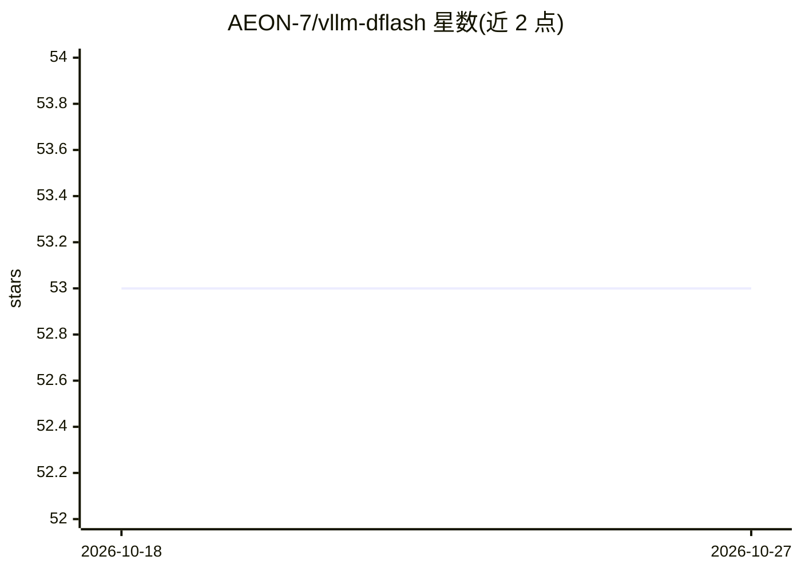

# AEON-7/vllm-dflash

⭐ 53 · Python · Apache-2.0 · 推送 2026-10-06 · [GitHub](https://github.com/AEON-7/vllm-dflash) · [官网](https://huggingface.co/AEON-7) · 个人维护

**面向 DGX Spark 的 vLLM 容器：DFlash 块扩散投机解码加速推理**

预构建的 vLLM Docker 镜像，针对 NVIDIA DGX Spark（GB10 Blackwell）调优，服务 AEON-7/DFlash-Qwen3.5-27B-Uncensored-NVFP4 模型（NVFP4 量化、混合线性+全注意力、支持视觉）。通过 DFlash 块扩散投机解码（k=15）加速解码，提供 OpenAI 兼容 API；可选启用 TurboQuant KV 缓存压缩（约 3% 开销，32K+ 长上下文解码下降约 11%）。仅支持 Blackwell 硬件（H100/A100 等不可用），需 ≥64GB 内存、≥580.x 驱动与 Docker ≥25.x。首次启动 5–10 分钟，模型下载 20GB。

## 筛选速览

| 维度 | 判定 | 备注 |
|---|---|---|
| AI 角色 | `ai-ecosystem` | LLM/agent 周边工具 |
| 许可风险 | `permissive` | Apache-2.0 |
| 部署形态 | `self-host` | docker 或自建部署 |
| 模型依赖 | — | README 未给出锁定关系 |
| 硬件要求 | `gpu-24g` | |
| 安装摩擦 | `low` | 无编译、无系统依赖或容器化 |
| 成熟度 | — | 结构信号不足 |

## 能力要点

- DFlash 块扩散投机解码（k=15），DGX Spark 上单流 64 tok/s（代码类 prompt）
- NVFP4 量化 + AWQ 校准，使用 Blackwell FP4 张量核心
- OpenAI 兼容 API（/v1/chat/completions 等）与 Bearer 鉴权
- 可选 TurboQuant KV 压缩（3.76× 压缩，适合高并发/长上下文）

## 适用场景

- 在 DGX Spark 上本地部署 27B 多模态模型并获得加速推理
- 多用户并发聊天或 agent 工作负载的服务端运行
- 长上下文高并发场景下通过 KV 压缩扩展会话容量

## 场景标签

`推理引擎` · 领域:训练与推理

## 证据(README 行号)

> L47: A pre-built vLLM container tuned for **NVIDIA DGX Spark (GB10 Blackwell)**, serving
> L53: - **OpenAI-compatible** `/v1/chat/completions`, `/v1/completions`, `/v1/models`, `/health`

## 星数曲线

2026-10-18 53 → 2026-10-27 53（+0）

---
*卡片 v1 · prompt 1.4 · 生成 2026-10-24 · 置信度 mid · 依据 README sha `639c5afc89aa` · [字段定义](../../DATASET.md)*
