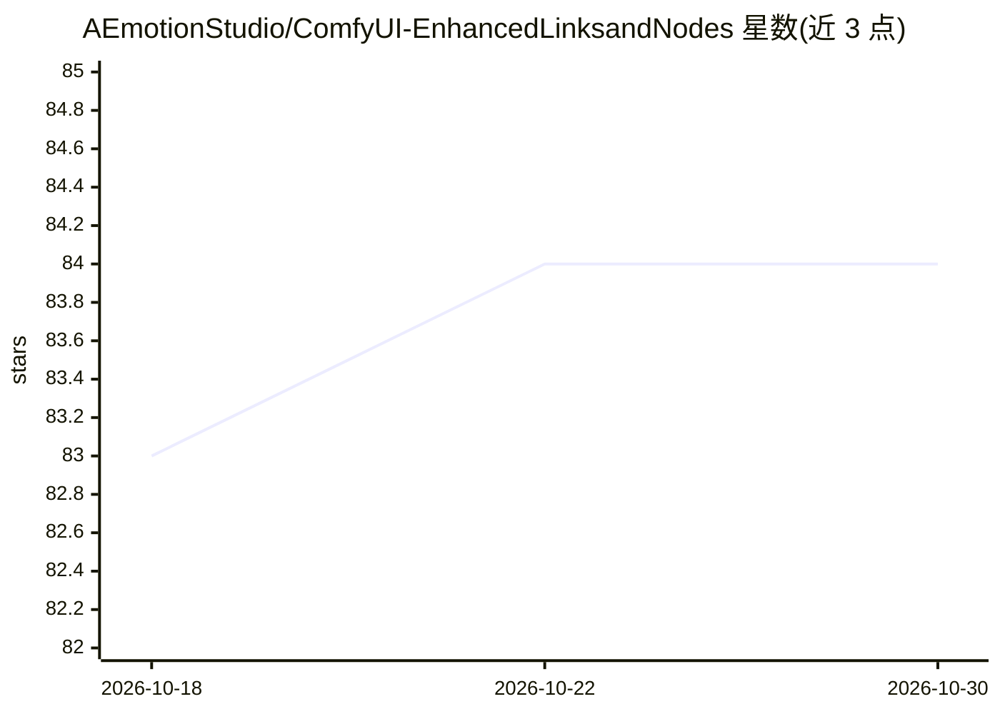

# AEmotionStudio/ComfyUI-EnhancedLinksandNodes

⭐ 84 · TypeScript · GPL-3.0 · 推送 2026-03-24 · [GitHub](https://github.com/AEmotionStudio/ComfyUI-EnhancedLinksandNodes) · [官网](https://aemotionstudio.org/) · 组织维护

**ComfyUI 界面扩展：为连线与节点添加可定制动画**

ComfyUI 的自定义节点扩展，为工作流编辑器提供视觉动画：9 种连线动画风格、13 种连线样式、4 种节点动画风格、独立粒子系统与 5 种文本动画。提供侧边栏设置面板、节点右键菜单、逐节点开关动画等配置途径，并含静态模式、渲染时暂停等性能选项。v2.0.1 为 TypeScript 重写版本，注册 60+ 项设置。声明无需额外依赖包，通过 ComfyUI Manager 或 git clone 安装。仅作用于界面视觉，不改变工作流计算逻辑。

## 筛选速览

| 维度 | 判定 | 备注 |
|---|---|---|
| AI 角色 | `ai-ecosystem` | LLM/agent 周边工具 |
| 许可风险 | `viral` | GPL-3.0 |
| 部署形态 | `None` |  |
| 模型依赖 | — | README 未给出锁定关系 |
| 硬件要求 | — | 无带数字的原话,不猜 |
| 安装摩擦 | `low` | 无编译、无系统依赖或容器化 |
| 成熟度 | — | 结构信号不足 |

## 能力要点

- 9 种连线动画与 13 种连线样式
- 4 种节点动画与独立粒子系统（6 种颜色模式）
- 侧边栏设置面板支持实时预览，注册 60+ 项设置
- 静态模式、渲染时暂停、粒子密度调节等性能选项

## 适用场景

- 为 ComfyUI 工作流编辑器定制视觉外观
- 通过完成动画获得节点任务完成的视觉反馈
- 重度工作流中关闭部分动画以保持性能

## 场景标签

 · 领域:开发工具/界面扩展

## 证据(README 行号)

> L3: **A visually stunning extension for ComfyUI that adds beautiful, customizable animations to both links and nodes in 
> L91: ### Option 1: ComfyUI Manager (Recommended)

## 星数曲线

2026-10-18 83 → 2026-10-30 84（+1）

---
*卡片 v1 · prompt 1.4 · 生成 2026-10-24 · 置信度 high · 依据 README sha `605ddf415694` · [字段定义](../../DATASET.md)*
